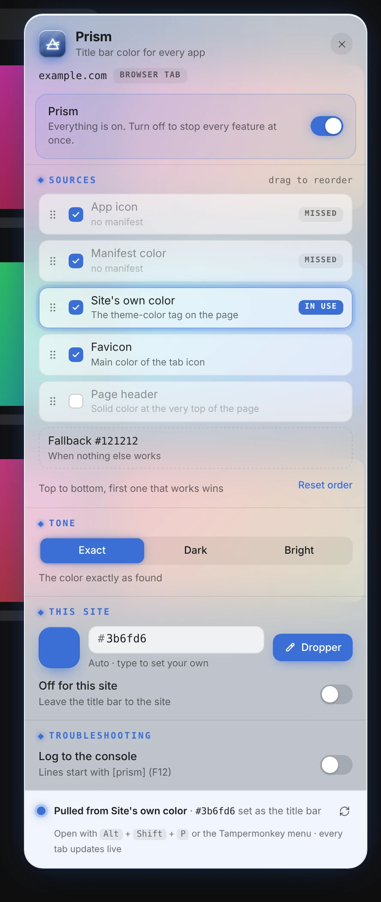
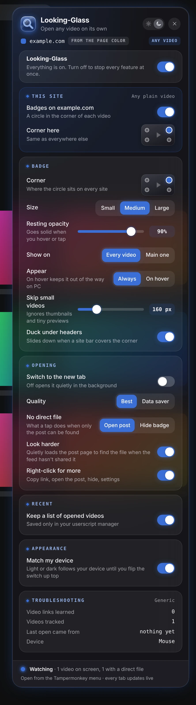
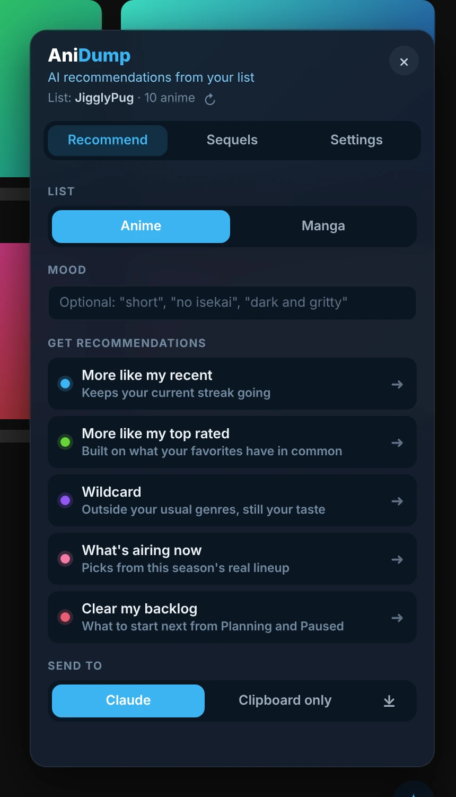

# userscripts

Userscripts by **JigglyPug** for [Tampermonkey](https://www.tampermonkey.net/). Each one updates itself from this repo.

  

## Desktop

| Script | What it does | Runs on | |
|---|---|---|---|
| [Prism](desktop/prism) | Title bar color for every app. | Every site | [Install](https://raw.githubusercontent.com/JigglyPug/userscripts/main/desktop/prism/prism.user.js) |
| [Hourglass](desktop/hourglass) | Screen time and lockdown for every site. | Every site | [Install](https://raw.githubusercontent.com/JigglyPug/userscripts/main/desktop/hourglass/hourglass.user.js) |
| [Looking-Glass](desktop/looking-glass) | Open any video on its own. | Every site; phone and PC | [Install](https://raw.githubusercontent.com/JigglyPug/userscripts/main/desktop/looking-glass/looking-glass.user.js) |
| [Molten Tools](desktop/molten-tools) | YouTube QOL tools. | YouTube, YouTube Music | [Install](https://raw.githubusercontent.com/JigglyPug/userscripts/main/desktop/molten-tools/molten-tools.user.js) |
| [Molten for Reddit](desktop/molten-for-reddit) | Molten glass for new Reddit. | reddit.com (new Reddit) | [Install](https://raw.githubusercontent.com/JigglyPug/userscripts/main/desktop/molten-for-reddit/molten-for-reddit.user.js) |
| [AniDump](desktop/anidump) | AI recommendations from your AniList list. | anilist.co, claude.ai | [Install](https://raw.githubusercontent.com/JigglyPug/userscripts/main/desktop/anidump/anidump.user.js) |

## Mobile

Made for phone browsers that support Tampermonkey (for example Edge on Android).

| Script | What it does | Runs on | |
|---|---|---|---|
| [AniDump Mobile](mobile/anidump-mobile) | Phone-friendly AniDump prompt builder. | anilist.co | [Install](https://raw.githubusercontent.com/JigglyPug/userscripts/main/mobile/anidump-mobile/anidump-mobile.user.js) |
| [Molten for Reddit Mobile](mobile/molten-for-reddit-mobile) | Molten glass for Reddit, pocket size. | reddit.com on your phone | [Install](https://raw.githubusercontent.com/JigglyPug/userscripts/main/mobile/molten-for-reddit-mobile/molten-for-reddit-mobile.user.js) |

## Installing

1. Install the [Tampermonkey](https://www.tampermonkey.net/) extension.
2. Click a script's **Install** link above. Tampermonkey opens an install page; click **Install** (or **Reinstall** / **Update** if you already have it).
3. That's it. Tampermonkey checks this repo for new versions on its own.

**Already have a script installed from somewhere else?** Install it from here once. If the name and namespace match, Tampermonkey updates your existing copy in place and keeps its settings. If you end up with two copies, delete the old one.

## How updates work

Every script's header points `@updateURL` and `@downloadURL` at its own file in this repo. Tampermonkey checks those once a day by default; you can change that in Tampermonkey → Settings → Script Update → Check Interval, or force it with **Check for userscript updates** in the Tampermonkey menu. An update installs only when the `@version` number goes up.

## Layout

```
desktop/<script>/<script>.user.js   the script
desktop/<script>/README.md          features and screenshots
desktop/<script>/images/            panel screenshots
mobile/...                          same, for the phone versions
```

Settings and stats are stored only in Tampermonkey on each device. Nothing in this repo contains personal data.
