

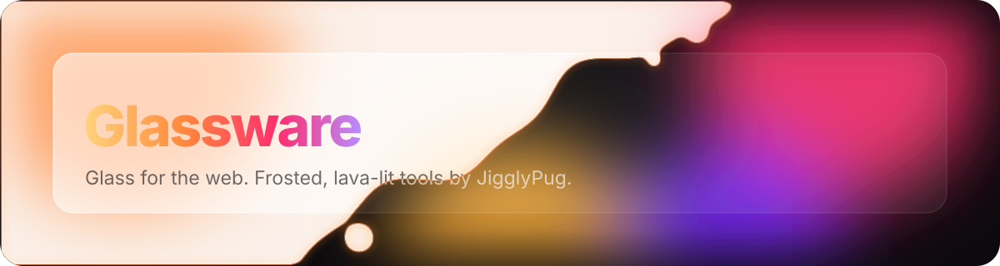

Built for [Tampermonkey](https://www.tampermonkey.net/). Every script updates itself from this repo.

## Where each script runs

| Script | Desktop | Phone | Runs on |
|---|:---:|:---:|---|
|  [Hourglass](desktop/hourglass) | ✓ | ✓ | Every site |
|  [Looking-Glass](desktop/looking-glass) | ✓ | ✓ | Every site |
| 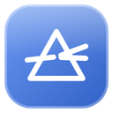 [Prism](desktop/prism) | ✓ |  | Every site |
| 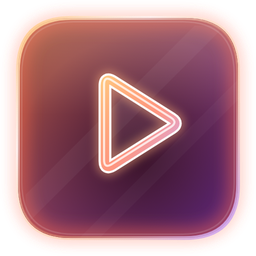 [Molten Tools](desktop/molten-tools) | ✓ |  | YouTube, YouTube Music |
|  [Molten for Reddit](desktop/molten-for-reddit) | ✓ | [Molten for Reddit Mobile](mobile/molten-for-reddit-mobile) ↗ | reddit.com (new Reddit) |
|  [Kaleidoscope](desktop/kaleidoscope) | ✓ | [Kaleidoscope Mobile](mobile/kaleidoscope-mobile) ↗ | anilist.co, claude.ai |
| 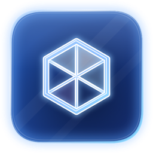 [Kaleidoscope Mobile](mobile/kaleidoscope-mobile) | [Kaleidoscope](desktop/kaleidoscope) ↗ | ✓ | anilist.co |
|  [Molten for Reddit Mobile](mobile/molten-for-reddit-mobile) | [Molten for Reddit](desktop/molten-for-reddit) ↗ | ✓ | reddit.com |

## Desktop and phone

<table>
<tr><td align="center" valign="top" width="50%"><a href="desktop/hourglass">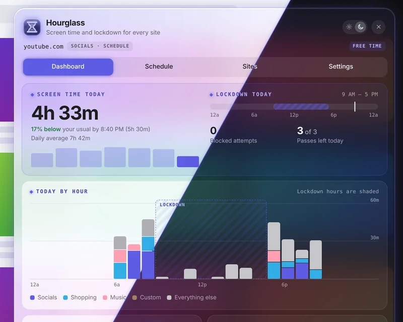</a> <h3> <a href="desktop/hourglass">Hourglass</a></h3>Screen time and lockdown for every site. Every site  </td><td align="center" valign="top" width="50%"><a href="desktop/looking-glass">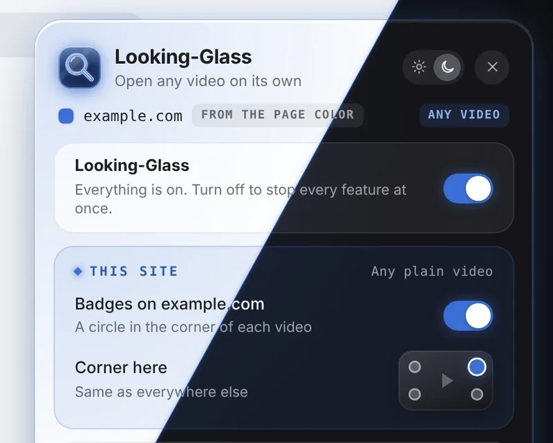</a> <h3> <a href="desktop/looking-glass">Looking-Glass</a></h3>Open any video on its own. Every site  </td></tr>
</table>

## Desktop

<table>
<tr><td align="center" valign="top" width="50%"><a href="desktop/prism">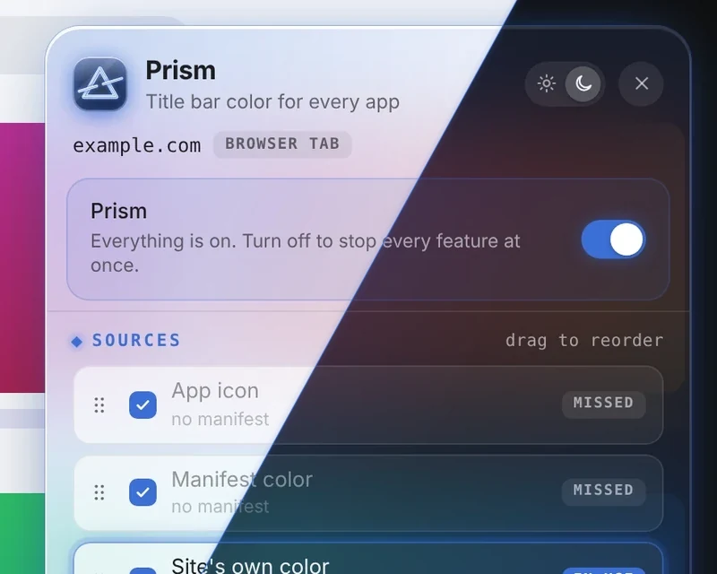</a> <h3> <a href="desktop/prism">Prism</a></h3>Every app title bar, in its site's own color. Every site  </td><td align="center" valign="top" width="50%"><a href="desktop/molten-tools">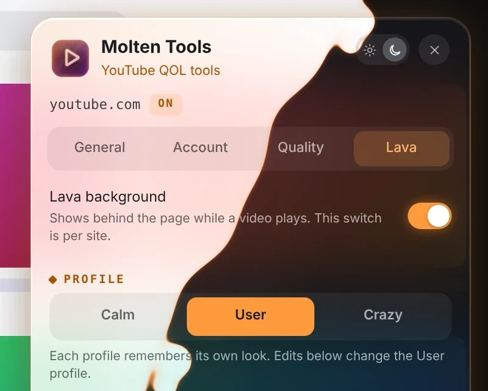</a> <h3> <a href="desktop/molten-tools">Molten Tools</a></h3>Molten glass and quality-of-life fixes for YouTube. YouTube, YouTube Music  </td></tr>
<tr><td align="center" valign="top" width="50%"><a href="desktop/molten-for-reddit">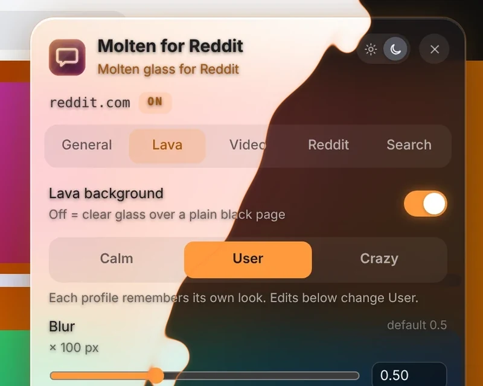</a> <h3> <a href="desktop/molten-for-reddit">Molten for Reddit</a></h3>Molten glass for new Reddit. reddit.com (new Reddit) Phone version: <a href="mobile/molten-for-reddit-mobile">Molten for Reddit Mobile</a>  </td><td align="center" valign="top" width="50%"><a href="desktop/kaleidoscope">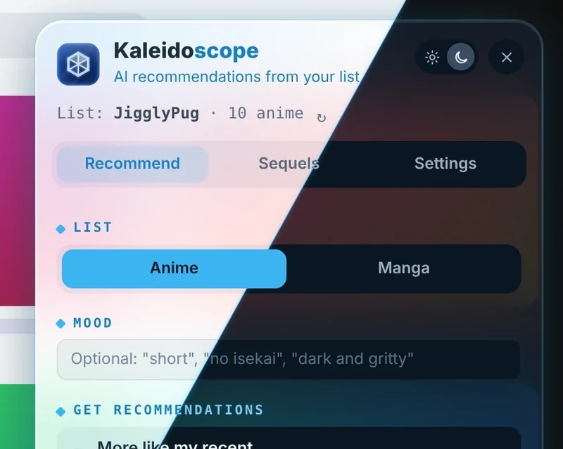</a> <h3> <a href="desktop/kaleidoscope">Kaleidoscope</a></h3>Your AniList list, turned into your next favorite. anilist.co, claude.ai Phone version: <a href="mobile/kaleidoscope-mobile">Kaleidoscope Mobile</a>  </td></tr>
</table>

## Phone

<table>
<tr><td align="center" valign="top" width="50%"><a href="mobile/kaleidoscope-mobile">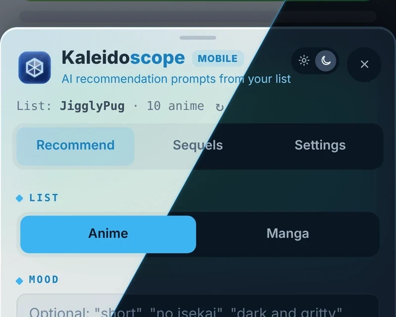</a> <h3> <a href="mobile/kaleidoscope-mobile">Kaleidoscope Mobile</a></h3>Kaleidoscope, made for your phone. anilist.co Desktop version: <a href="desktop/kaleidoscope">Kaleidoscope</a>  </td><td align="center" valign="top" width="50%"><a href="mobile/molten-for-reddit-mobile">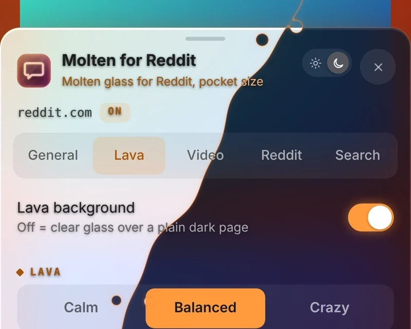</a> <h3> <a href="mobile/molten-for-reddit-mobile">Molten for Reddit Mobile</a></h3>Molten glass for Reddit, pocket size. reddit.com Desktop version: <a href="desktop/molten-for-reddit">Molten for Reddit</a>  </td></tr>
</table>
