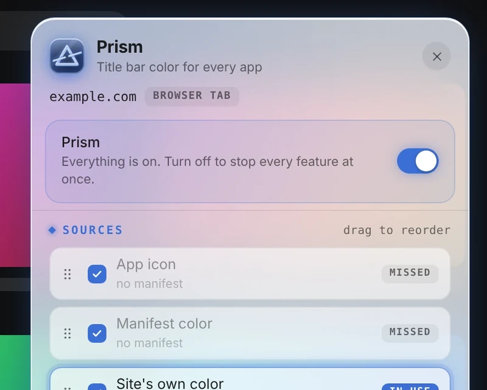
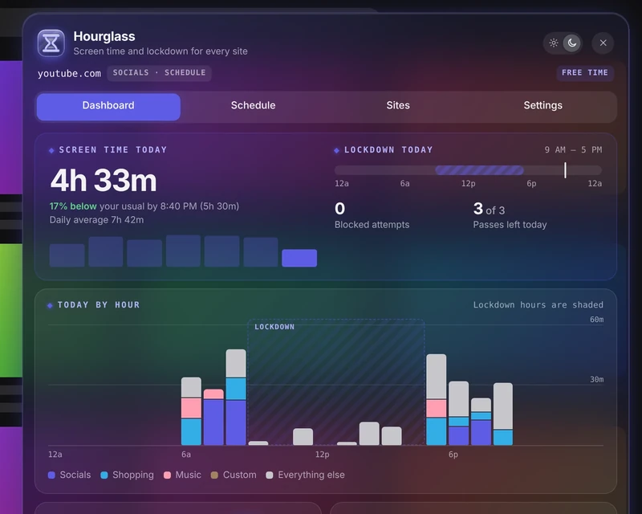
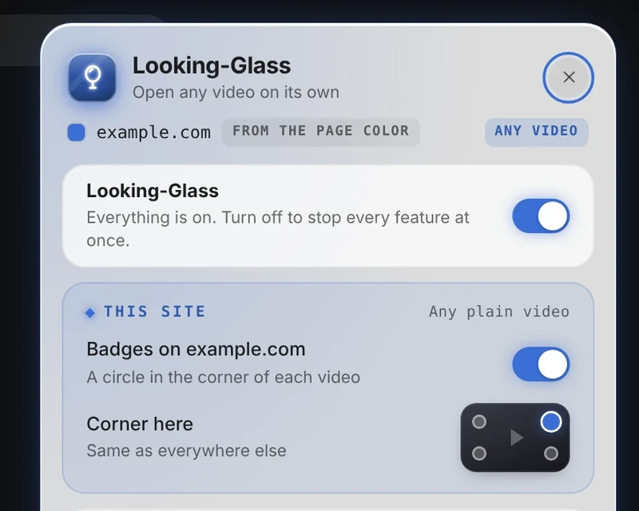
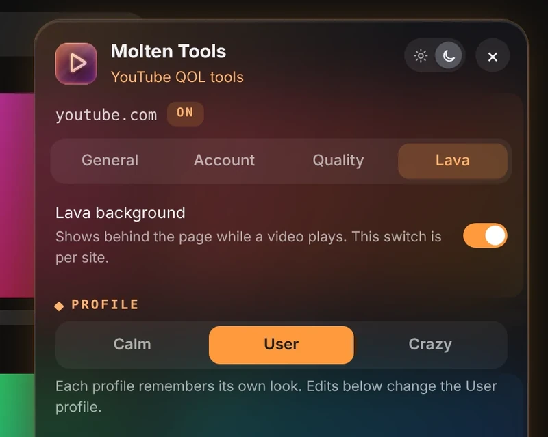
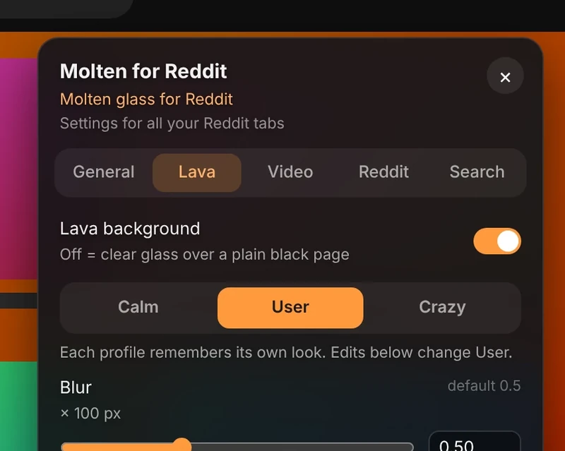
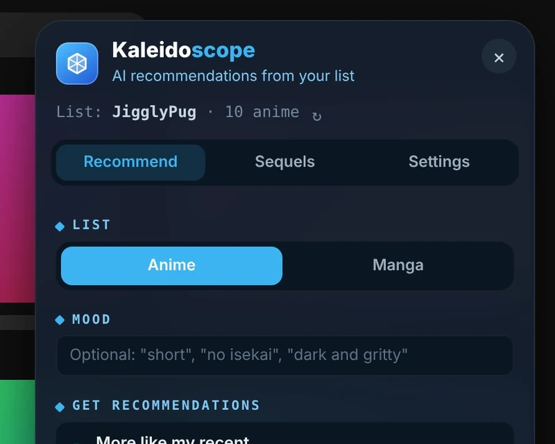
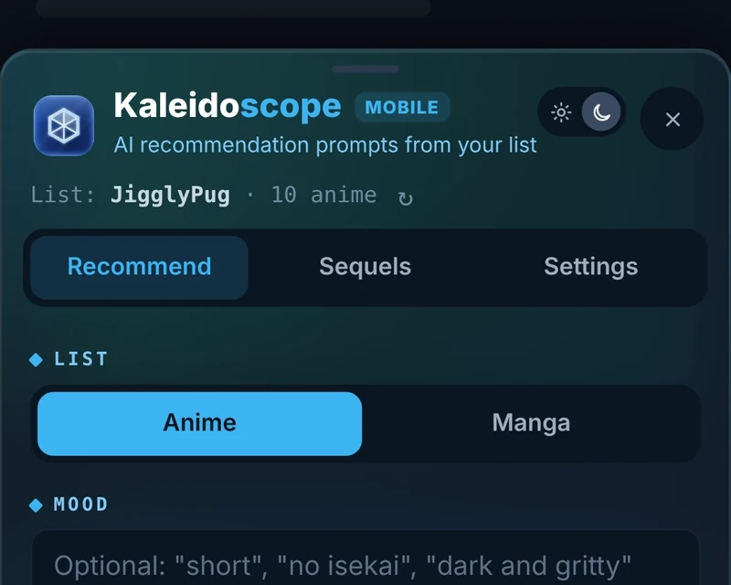
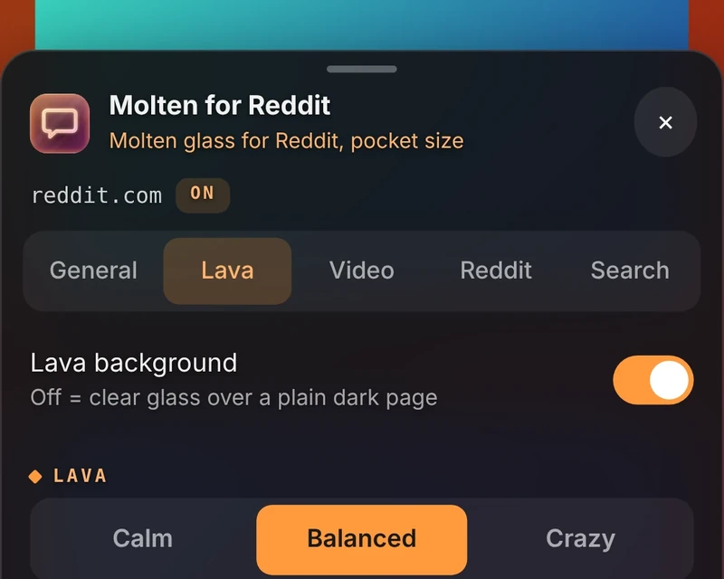

Built for [Tampermonkey](https://www.tampermonkey.net/). Every script updates itself from this repo.

## Desktop

<table>
<tr><td align="center" valign="top" width="50%"> <h3> <a href="desktop/prism">Prism</a></h3>Every app title bar, in its site's own color. Every site  </td><td align="center" valign="top" width="50%"> <h3> <a href="desktop/hourglass">Hourglass</a></h3>Screen time and lockdown for every site. Every site; phone and PC  </td></tr>
<tr><td align="center" valign="top" width="50%"> <h3> <a href="desktop/looking-glass">Looking-Glass</a></h3>Open any video on its own. Every site; phone and PC  </td><td align="center" valign="top" width="50%"> <h3> <a href="desktop/molten-tools">Molten Tools</a></h3>Molten glass and quality-of-life fixes for YouTube. YouTube, YouTube Music  </td></tr>
<tr><td align="center" valign="top" width="50%"> <h3> <a href="desktop/molten-for-reddit">Molten for Reddit</a></h3>Molten glass for new Reddit. reddit.com (new Reddit)  </td><td align="center" valign="top" width="50%"> <h3> <a href="desktop/kaleidoscope">Kaleidoscope</a></h3>Your AniList list, turned into your next favorite. anilist.co, claude.ai  </td></tr>
</table>

## Mobile

<table>
<tr><td align="center" valign="top" width="50%"> <h3> <a href="mobile/kaleidoscope-mobile">Kaleidoscope Mobile</a></h3>Kaleidoscope, made for your phone. anilist.co  </td><td align="center" valign="top" width="50%"> <h3> <a href="mobile/molten-for-reddit-mobile">Molten for Reddit Mobile</a></h3>Molten glass for Reddit, pocket size. reddit.com on your phone  </td></tr>
</table>
