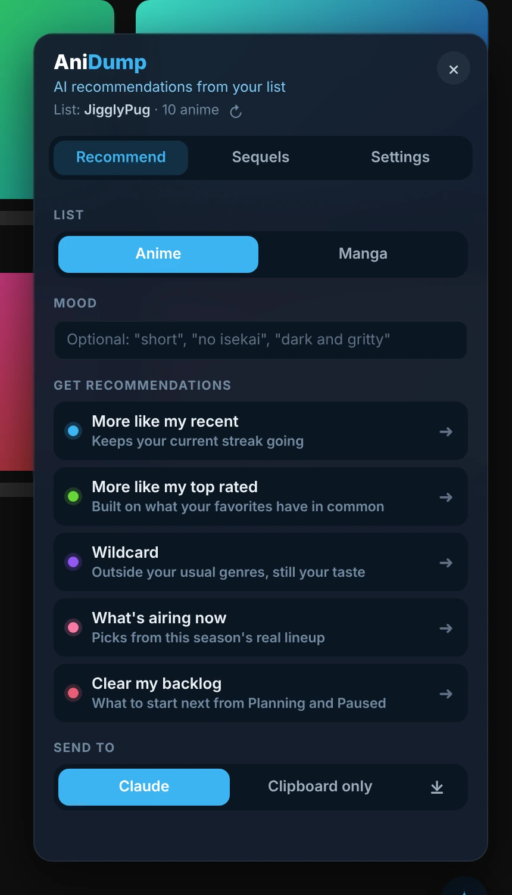
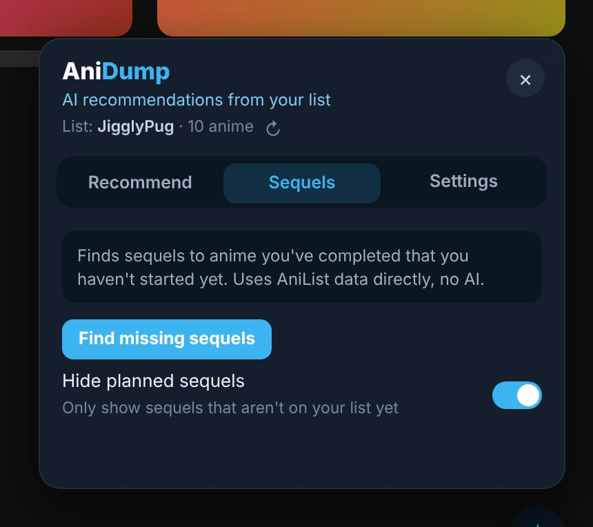
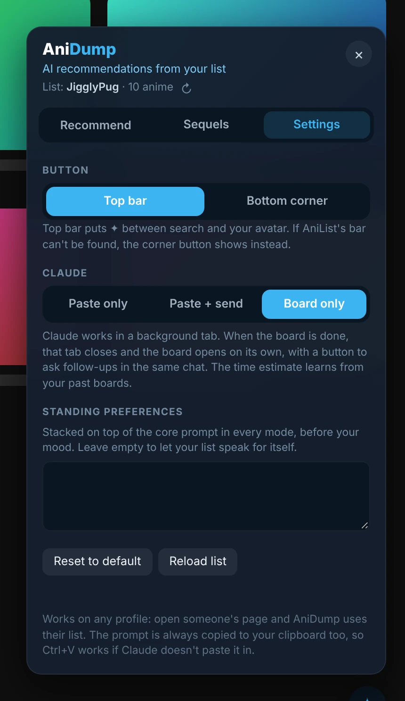

# AniDump

> AI recommendations from your AniList list.

**[Install](https://raw.githubusercontent.com/JigglyPug/userscripts/main/desktop/anidump/anidump.user.js)** · v2.7.5 · Runs on: anilist.co, claude.ai

Click the ✦ button on AniList and pick a mode. AniDump has Claude build a recommendation board from your list in the background, then opens it for you.

## Features

- **Five modes**: more like my recent, more like my top rated, wildcard, what's airing now, clear my backlog. Works for anime and manga.
- **Optional mood** ("short", "no isekai", "dark and gritty").
- **Send to Claude** (board only, paste only, or paste and send), or copy the prompt to the clipboard.
- **Sequel finder**: sequels to things you have completed but not started, straight from AniList data with no AI.
- **Standing preferences** added to every prompt.
- Button in the top bar or the bottom corner.

## Screenshots

**Recommend**

**Sequels**

**Settings**

_Needs you to be signed in to claude.ai in the same browser for the Claude features._
