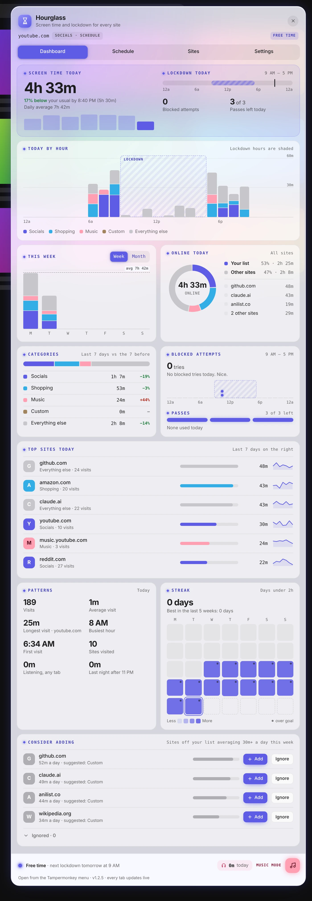

 

 

Hourglass tracks how long you spend on every site and blocks the distracting ones on a schedule. During lockdown the settings lock too, so you cannot talk yourself out of it in the moment.

## Features

- **A real dashboard**: Today against your average, an hour-by-hour chart with lockdown shaded, week and month views, category trends, top sites and streaks.
- **A schedule you draw**: Drag lockdown blocks onto each day in 30-minute steps, or start from presets like 9–5, evenings or overnight.
- **Passes, not loopholes**: A few daily passes that open only the site you're on, with a timer and a wait to think it over.
- **Lockdown that holds**: An "Is this important?" screen with a delay, and looser settings only kick in after lockdown ends.
- **Your lists**: Socials, Shopping, Music and Custom. Each site can follow the schedule or stay blocked.
- **Smart suggestions**: Sites you spend 30+ minutes a day on get suggested for a list, or you can ignore them.
- **Music mode**: Let music through during lockdown, with listening time tracked apart from screen time.
- **Late-night nudge**: A friendly reminder to take a break when you're still browsing past bedtime.
- **Private by design**: Everything stays on your device, and only site names are kept, never full addresses or page titles.

## A closer look

<table>
<tr><td align="center" valign="top"> <b>Schedule</b></td><td align="center" valign="top"> <b>Sites</b></td></tr>
<tr><td align="center" valign="top"> <b>Settings</b></td></tr>
</table>
