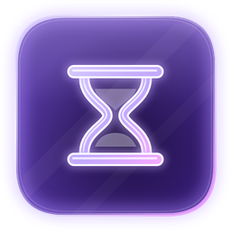
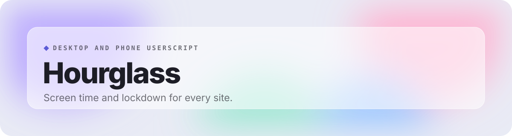
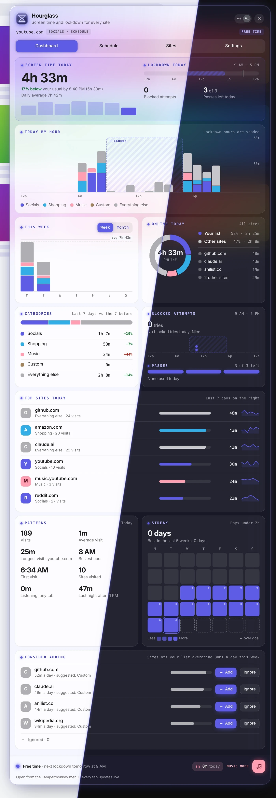
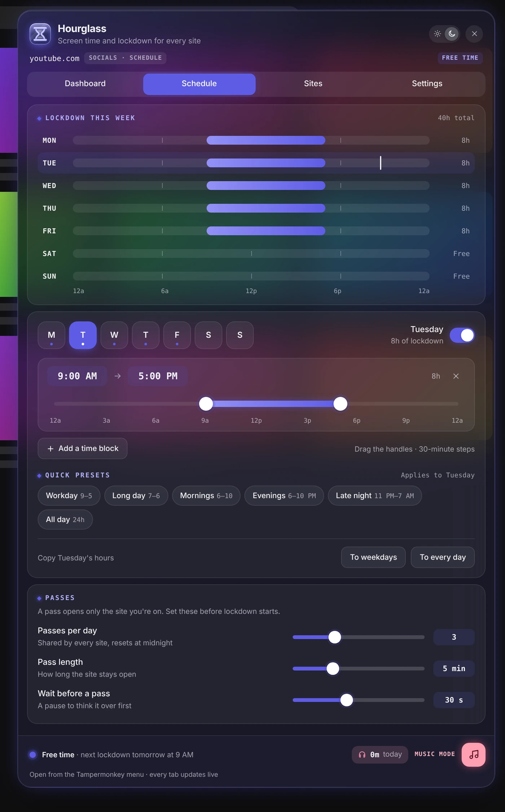
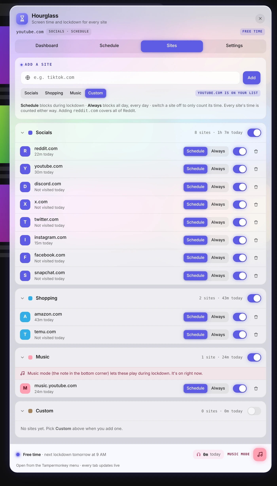
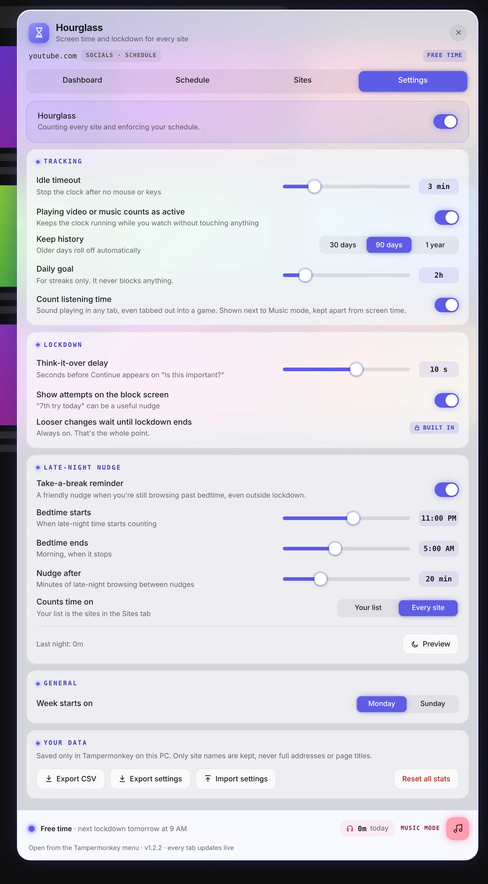
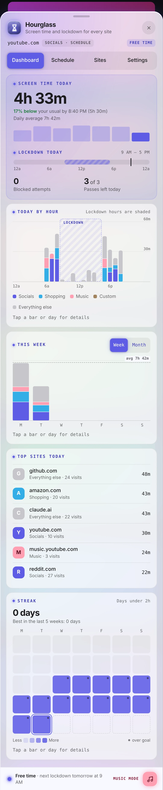
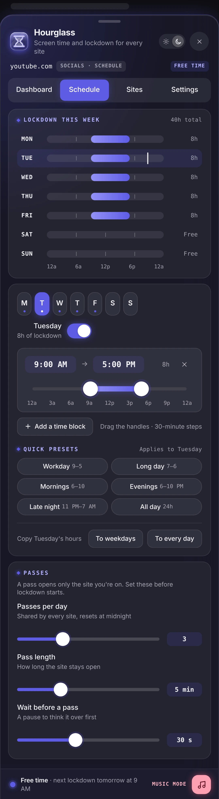
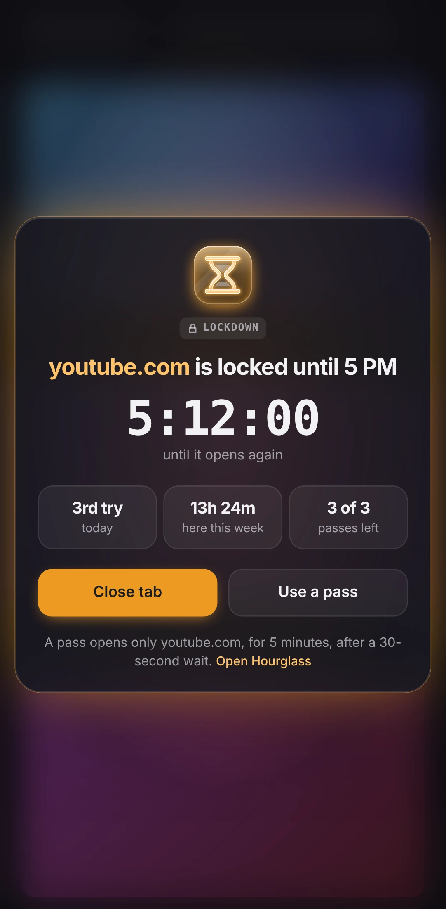
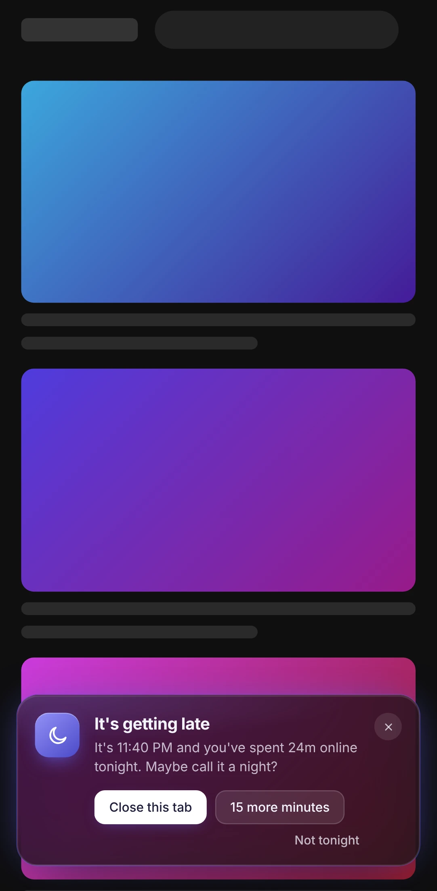

 

 

Hourglass tracks how long you spend on every site and blocks the distracting ones on a schedule. During lockdown the settings lock too, so you cannot talk yourself out of it in the moment.

## Getting started

A fresh install starts in setup mode: Hourglass counts your screen time but blocks nothing and locks no settings. Check your sites and schedule, then tap **Start lockdown** on the welcome card. If you start during scheduled hours, you can begin right away or wait until the current block ends.

## Features

- **A dashboard that tells you something**: Each card answers one question in a sentence: how today compares with your usual, what changed, when you drift and whether lockdown is working.
- **A schedule you draw**: Drag lockdown blocks onto each day in 30-minute steps, or start from presets like 9–5, evenings or overnight.
- **Passes, not loopholes**: A few daily passes that open only the site you're on, with a timer and a wait to think it over.
- **Lockdown that holds**: An "Is this important?" screen with a delay, and looser settings only kick in after lockdown ends.
- **Your lists**: Socials, Shopping, Music and Custom. Each site can follow the schedule or stay blocked.
- **Smart suggestions**: Sites you spend 30+ minutes a day on get suggested for a list, or you can ignore them.
- **Music mode**: Let music through during lockdown, with listening time tracked apart from screen time.
- **Late-night nudge**: A friendly reminder to take a break when you're still browsing past bedtime.
- **On your phone too**: The same script switches to a bottom-sheet menu on phones, with the full dashboard in one column, bigger touch targets and tap-for-details charts. Listening time stays on the PC.
- **Private by design**: Everything stays on your device, and only site names are kept, never full addresses or page titles.

## A closer look

<table>
<tr><td align="center" valign="top"><picture><source media="(prefers-color-scheme: light)" srcset="images/schedule-light.webp"></picture> <b>Schedule</b></td><td align="center" valign="top"><picture><source media="(prefers-color-scheme: light)" srcset="images/sites-light.webp"></picture> <b>Sites</b></td></tr>
<tr><td align="center" valign="top"><picture><source media="(prefers-color-scheme: light)" srcset="images/settings-light.webp"></picture> <b>Settings</b></td></tr>
</table>

## On your phone

The same script switches to a phone layout on its own: a bottom-sheet menu, the same dashboard in one column with charts you can tap for details, and bigger touch targets. Open it from the Tampermonkey menu, or from the Open Hourglass link on any block screen.

<table>
<tr><td align="center" valign="top"><picture><source media="(prefers-color-scheme: light)" srcset="images/phone-dashboard-light.webp"></picture> <b>Dashboard</b></td><td align="center" valign="top"><picture><source media="(prefers-color-scheme: light)" srcset="images/phone-schedule-light.webp"></picture> <b>Schedule</b></td><td align="center" valign="top"><picture><source media="(prefers-color-scheme: light)" srcset="images/phone-block-light.webp"></picture> <b>Block screen</b></td><td align="center" valign="top"><picture><source media="(prefers-color-scheme: light)" srcset="images/phone-nudge-light.webp"></picture> <b>Late-night nudge</b></td></tr>
</table>
