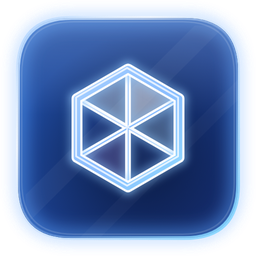
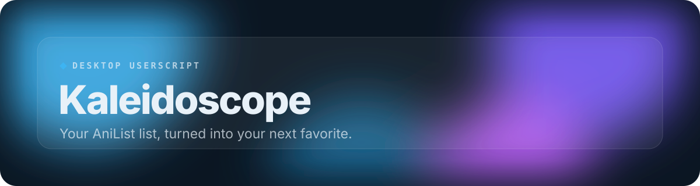
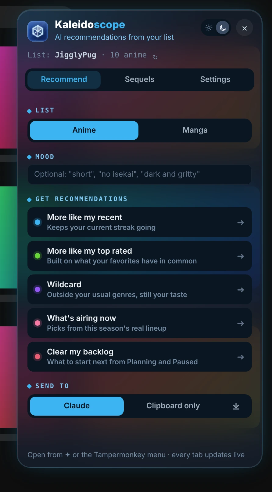
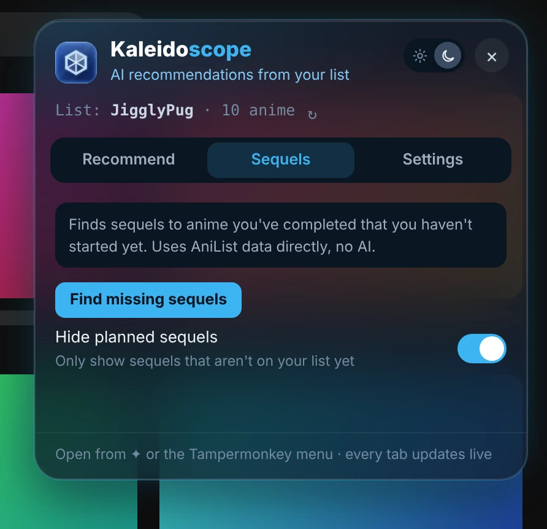
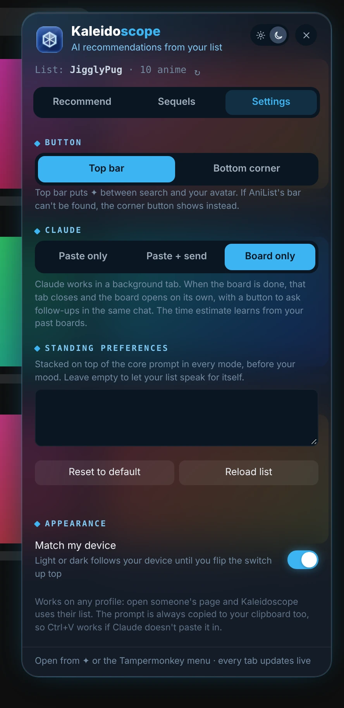

 

 

Click the ✦ button on AniList and pick a mode. Kaleidoscope has Claude build a recommendation board from your list in the background, then opens it for you.

## Features

- **Five ways to find your next show**: More like my recent, more like my top rated, wildcard, what's airing now and clear my backlog. For anime and manga.
- **Built from your actual list**: Your AniList history drives every recommendation, with an optional mood like "short" or "no isekai".
- **Hands it to Claude**: Claude builds a recommendation board in the background and Kaleidoscope opens it for you. Or just copy the prompt.
- **Sequel finder**: Finds sequels to things you've finished but haven't started, straight from AniList.
- **Your standing preferences**: Taste notes added to every prompt, if you want them.

**Requires:** a claude.ai account, signed in in the same browser, for the Claude features. Clipboard mode works without one.

## A closer look

<table>
<tr><td align="center" valign="top"> <b>Sequels</b></td><td align="center" valign="top"> <b>Settings</b></td></tr>
</table>
