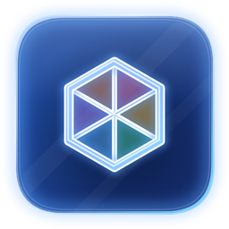
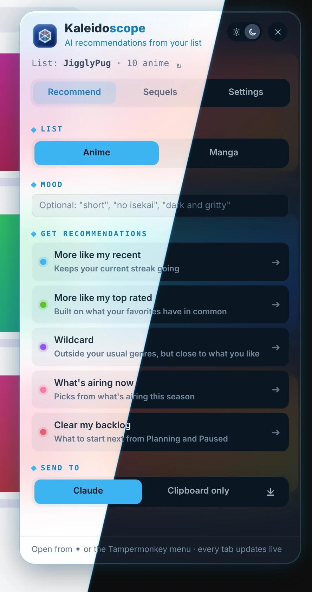
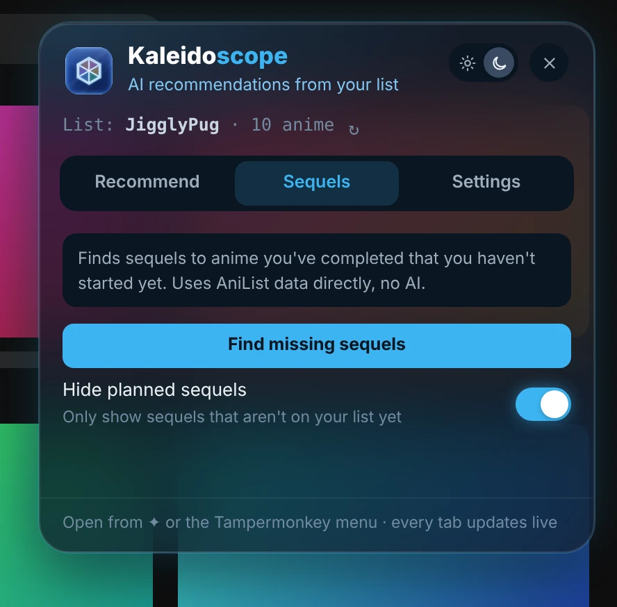
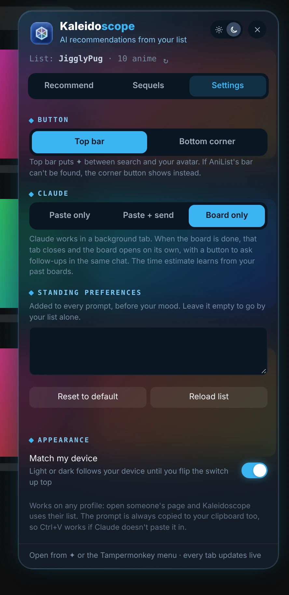

 

 

Click the ✦ button on AniList and pick a mode. Kaleidoscope has Claude build a recommendation board from your list in the background, then opens it for you.

## Features

- **Five ways to find your next show**: More like my recent, more like my top rated, wildcard, what's airing now and clear my backlog. For anime and manga.
- **Built from your actual list**: Your AniList history drives every recommendation, with an optional mood like "short" or "no isekai".
- **Hands it to Claude**: Claude builds a recommendation board in the background and Kaleidoscope opens it for you. Or just copy the prompt.
- **Follow-ups land on the board**: Talk the board over in its Claude chat. When Claude changes it there, your saved board changes too.
- **Sequel finder**: Finds sequels to things you've finished but haven't started, straight from AniList.
- **Your standing preferences**: Taste notes added to every prompt, if you want them.

**Requires:** a claude.ai account, signed in in the same browser, for the Claude features. Clipboard mode works without one.

## A closer look

<table>
<tr><td align="center" valign="top"><picture><source media="(prefers-color-scheme: light)" srcset="images/sequels-light.webp"></picture> <b>Sequels</b></td><td align="center" valign="top"><picture><source media="(prefers-color-scheme: light)" srcset="images/settings-light.webp"></picture> <b>Settings</b></td></tr>
</table>

## What's new

- **2.10.15** (2026-11-21): Follow-up now keeps your board in step. Ask Claude for changes in the board's chat, and when it edits the board or sends a new one, your saved board updates and the open board page shows it. Plain answers leave it alone. Claude's tab says when the board was updated, with a button to open it, or that the changes didn't fit and the board is unchanged.
- **2.10.14** (2026-11-19): A new icon in the family style: the gem with each facet in a soft color.
- **2.10.13** (2026-11-19): A few lines in the panel read more plainly: the Standing preferences hint, the Wildcard and What's airing now hints, the sequel finder when nothing is missing, and the button for making a new board anyway.

[Every change](CHANGES.md)
