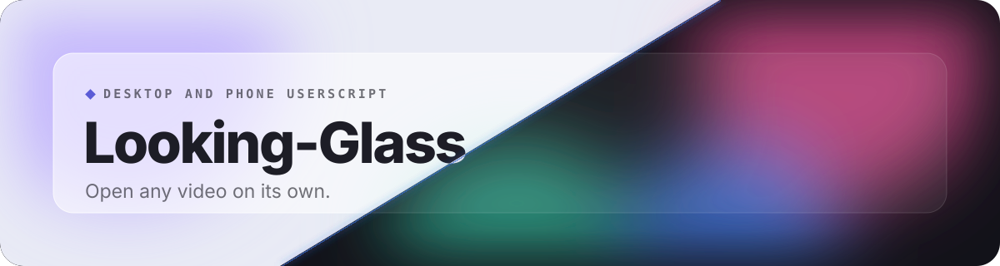
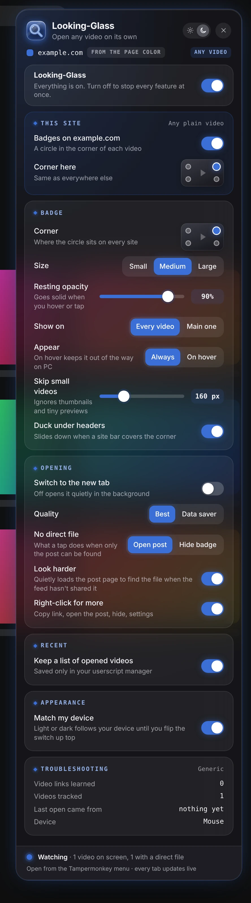

 

 

Looking-Glass puts a small circle in the corner of every video, in the site's own color. Tap it to open the video file in its own tab. It works on Facebook, Instagram, Reddit, X, TikTok, YouTube and any page with a plain video.

## Features

- **One tap to the source**: Opens the video file itself in a new tab, in the background or right in front of you.
- **Works almost anywhere**: Facebook, Instagram, Reddit, X, TikTok, YouTube and any page with a plain video.
- **A badge in the site's color**: Pick the corner, size and resting opacity. Show it on every video or the main one, always or on hover.
- **Stays out of the way**: Skips thumbnails and tiny previews, and slides under headers that would cover it.
- **Best or data saver**: Choose the sharpest file or the lighter one.
- **Looks harder**: When the feed hides the file, it quietly checks the post page, or opens the post instead.
- **Right-click for more**: Copy the link, open the post, hide the badge or jump to settings.
