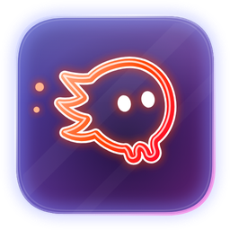
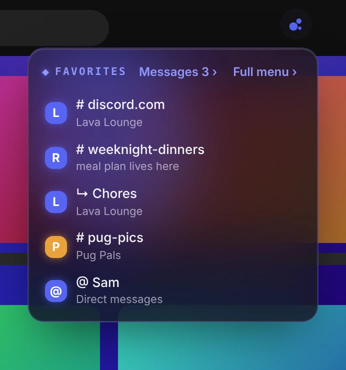
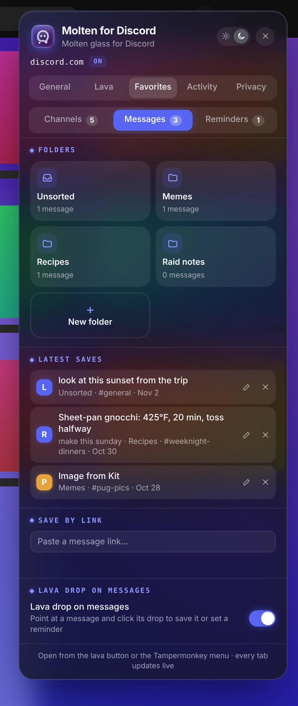
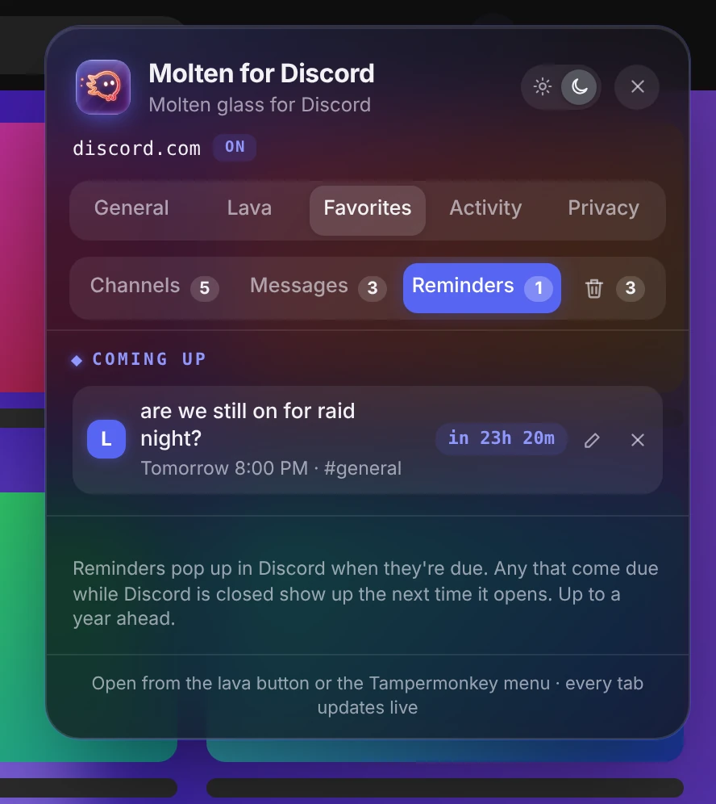

 

 

Molten for Discord puts a lava-lamp background made from what you're looking at behind frosted-glass panes, and keeps your favorite channels one point away on the lava button.

## Features

- **Lava from what you're looking at**: The background comes from the image, video or stream in the middle of the chat, or the profile you open. With nothing on screen it takes the server's icon colors, or Discord purple.
- **Glass over the lava**: The server list, channels, chat and member list turn to frosted glass, with Calm, User and Crazy profiles that each keep their own look.
- **Favorites on the lava button**: Point at the lava button and your favorite channels, threads and DMs drip down from it. Reorder them, color them by server and see Recent in the panel.
- **Saved messages and reminders**: Point at a message and click its lava drop to save it to a folder of your own, or to be reminded later, with a note saying why. Reminders you missed while Discord was closed show up when it opens.
- **Your activity, at a glance**: Where your Discord time goes as a cluster of bubbles, one per server or DM: point at one and it swells, click it to go there. Daily time, messages and busy hours sit beside it, compared with your own history, and none of it leaves your browser.
- **Voice in the lava**: In a call, the lava takes the avatar of whoever is talking.
- **Mentions and keywords that glow**: Messages that mention you, or use words you pick, get a lava glow instead of a flat bar, with lava blobs around them if you like.
- **Colors from the art**: The title bar and the video seek bar take their color from the lava. When nothing on screen gives a color, Prism takes the title bar back.
- **Screenshot safe and privacy blur**: Hide your own name and avatar, and blur images, DMs, server icons or whole channels until you point at them.
- **Easy on your GPU**: The lava pauses while you scroll and when Discord isn't the active window, and calms down during calls and streams.

## A closer look

<table>
<tr><td align="center" valign="top"><picture><source media="(prefers-color-scheme: light)" srcset="images/lava-light.webp"></picture> <b>Lava</b></td><td align="center" valign="top"><picture><source media="(prefers-color-scheme: light)" srcset="images/favorites-light.webp"></picture> <b>Favorites</b></td></tr>
<tr><td align="center" valign="top"><picture><source media="(prefers-color-scheme: light)" srcset="images/quick-favorites-light.webp"></picture> <b>Favorites on hover</b></td><td align="center" valign="top"><picture><source media="(prefers-color-scheme: light)" srcset="images/messages-light.webp"></picture> <b>Saved messages</b></td></tr>
<tr><td align="center" valign="top"><picture><source media="(prefers-color-scheme: light)" srcset="images/reminders-light.webp"></picture> <b>Reminders</b></td><td align="center" valign="top"><picture><source media="(prefers-color-scheme: light)" srcset="images/activity-light.webp"></picture> <b>Activity</b></td></tr>
<tr><td align="center" valign="top"><picture><source media="(prefers-color-scheme: light)" srcset="images/privacy-light.webp"></picture> <b>Privacy</b></td></tr>
</table>

## What's new

- **1.0.10** (2026-11-19): The bubbles card says it the way you'd say it ("Lava Lounge took a third of your Discord time"), and "What changed?" puts a big jump in words ("more than halved"). The bubble key is in plain sentences, and the line under the bubbles shows the biggest one until you point at one. Settings descriptions say what happens when a switch is off in a sentence, and a few read more clearly. The last date under the day charts no longer drops onto a second line when the range ends in a part-week.
- **1.0.9** (2026-11-18): A new icon: a leaning lava blob with flame and drips, in Molten for Reddit's orange and Molten Tools' red on Discord's purple.
- **1.0.8** (2026-11-17): The save menu waits for you. Picking a folder or a reminder time used to save the message on the spot and close the menu; now they're just picks, and the button at the bottom is Save. Fill in any of the note, the folder and the reminder, change your mind as often as you like, and Save does all of it at once. A line above the button says what it will do. Pick only a reminder and you get just the reminder; pick nothing and the message goes to Unsorted. "No reminder" undoes a time you picked.

[Every change](CHANGES.md)
