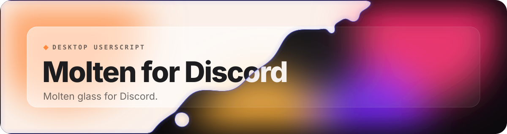
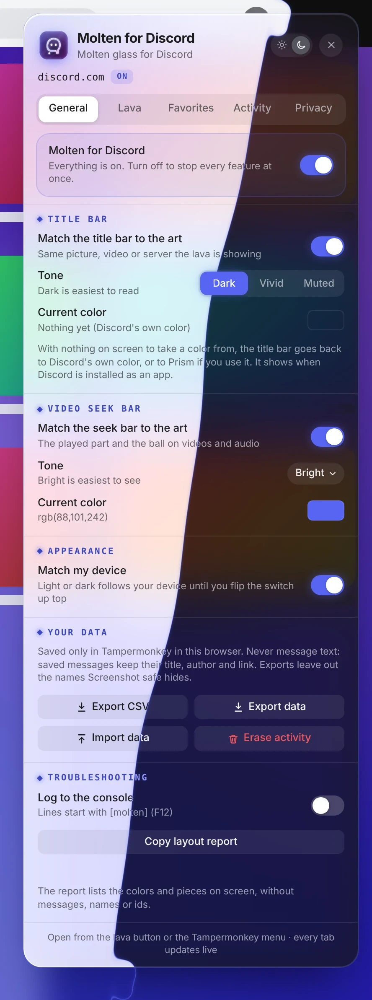
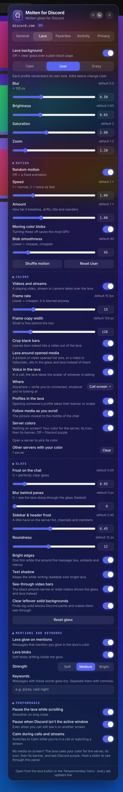
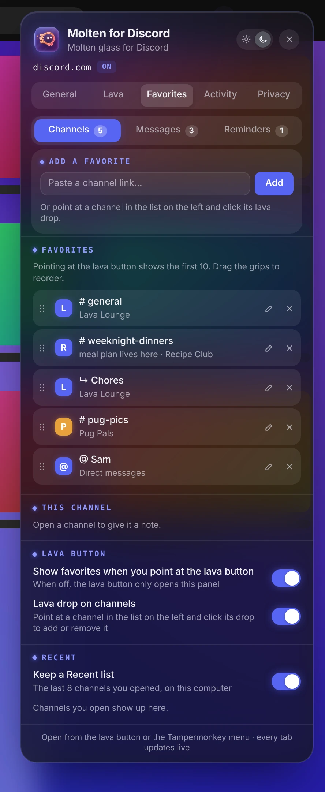
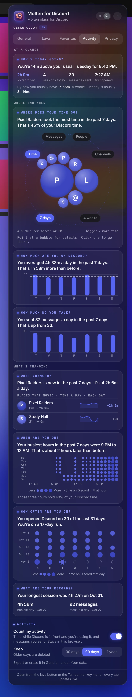
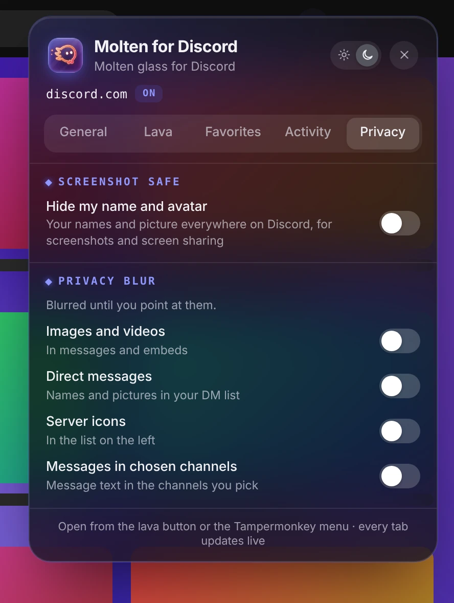

 

 

Molten for Discord puts a lava-lamp background made from what you're looking at behind frosted-glass panes, and keeps your favorite channels one point away on the lava button.

## Features

- **Lava from what you're looking at**: The background comes from the image, video or stream in the middle of the chat, or the profile you open. With nothing on screen it takes the server's icon colors, or Discord purple.
- **Glass over the lava**: The server list, channels, chat and member list turn to frosted glass, with Calm, User and Crazy profiles that each keep their own look.
- **Favorites on the lava button**: Point at the lava button and your favorite channels, threads and DMs drip down from it. Reorder them, color them by server and see Recent in the panel.
- **Saved messages and reminders**: Point at a message and click its lava drop to save it to a folder of your own, or to be reminded later, with a note saying why. Reminders you missed while Discord was closed show up when it opens.
- **Your activity, at a glance**: Where your Discord time goes as a cluster of bubbles, one per server or DM: point at one and it swells, click it to go there. Daily time, messages and busy hours sit beside it, compared with your own history, and none of it leaves your browser.
- **Voice in the lava**: In a call, the lava takes the avatar of whoever is talking.
- **Mentions and keywords that glow**: Messages that mention you, or use words you pick, get a lava glow instead of a flat bar, with lava blobs around them if you like.
- **Colors from the art**: The title bar and the video seek bar take their color from the lava. When nothing on screen gives a color, Prism takes the title bar back.
- **Screenshot safe and privacy blur**: Hide your own name and avatar, and blur images, DMs, server icons or whole channels until you point at them.
- **Easy on your GPU**: The lava pauses while you scroll and when Discord isn't the active window, and calms down during calls and streams.

## A closer look

<table>
<tr><td align="center" valign="top"><picture><source media="(prefers-color-scheme: light)" srcset="images/lava-light.webp"></picture> <b>Lava</b></td><td align="center" valign="top"><picture><source media="(prefers-color-scheme: light)" srcset="images/favorites-light.webp"></picture> <b>Favorites</b></td></tr>
<tr><td align="center" valign="top"><picture><source media="(prefers-color-scheme: light)" srcset="images/messages-light.webp"></picture> <b>Saved messages</b></td><td align="center" valign="top"><picture><source media="(prefers-color-scheme: light)" srcset="images/reminders-light.webp"></picture> <b>Reminders</b></td></tr>
<tr><td align="center" valign="top"><picture><source media="(prefers-color-scheme: light)" srcset="images/activity-light.webp"></picture> <b>Activity</b></td><td align="center" valign="top"><picture><source media="(prefers-color-scheme: light)" srcset="images/privacy-light.webp"></picture> <b>Privacy</b></td></tr>
</table>

## What's new

- **1.0.3** (2026-11-17): Lighter while a video or stream plays: only the lava's video follows the frame rate now. Keeping the button in place, cleaning the page, checking reminders and counting activity stay on their own clock, instead of running up to 60 times a second. Switched off, Molten stops watching the page entirely. Reminders: at the limit of 100, a new one never pushes out one that's due sooner (a finished reminder goes first, then the one furthest away). "In 1 month" from the 31st stops at the end of next month instead of spilling into the one after. Export CSV: a server or channel named like a spreadsheet formula starts with an apostrophe, so a spreadsheet shows it as text instead of running it. Export data leaves out the names Screenshot safe hides inside saved messages, reminders and notes too (they read "User"). Your data now says what a saved message keeps: a short preview (its first 80 characters), its author and a link.
- **1.0.2** (2026-11-17): **Your data** in General, laid out like Hourglass's: **Export CSV** (your activity, a row per day and channel), **Export data** (settings, lava looks, favorites, saved messages, reminders, notes, server colors), **Import data** (adds what's in a backup to what you have; nothing is removed) and **Erase activity**, which asks first and waits for OK. Exports leave out the names Screenshot safe hides. Erasing activity moved here from the Activity tab. Mention blobs: every message gets its own blobs, in their own places, at their own speed, instead of a run of mentions playing the same animation side by side. The icon shows in Tampermonkey's list again: if it didn't download when you installed, this update fetches it.
- **1.0.1** (2026-11-17): Channels opened while they had unread messages showed as "• Discord". Names now come from the channel list, and names saved that way fix themselves. Screenshot safe now blurs your hidden names inside Molten's own panel, favorites, popups and Activity tab too, word by word. Point at anything Screenshot safe blurred to see it. A screenshot can't point, so it stays hidden there. A blurred name no longer stays blurred after you switch servers: what Discord reuses for the next server's name comes out of the blur. Names are matched as whole words, so hiding "Sam" no longer blurs "Samsung". Mention blobs are round drops of a fixed size that rise and sink inside the glow, instead of blurred ovals stretched across the chat. Mentions in a row share one box with a straight bar down the left.

[Every change](CHANGES.md)
