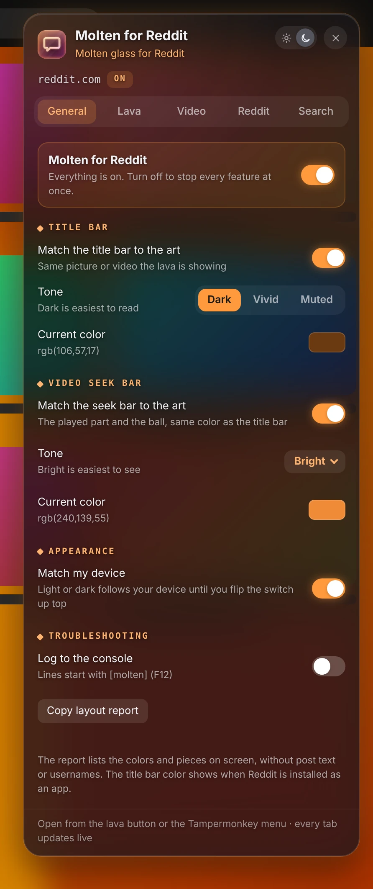

# Molten for Reddit

> Molten glass for new Reddit.

**[Install](https://raw.githubusercontent.com/JigglyPug/userscripts/main/desktop/molten-for-reddit/molten-for-reddit.user.js)** · v2.2.8 · Runs on: reddit.com (new Reddit)

Molten for Reddit puts a lava-lamp background made from the image or video you are looking at behind clear-glass posts and comments. Click the orange lava button in the top bar for settings.

## Features

- **Lava background** from the post in the middle of the screen (falls back to the subreddit banner or icon), with Calm / User / Crazy profiles.
- **Glass controls**: frost, blur, roundness, outline and text shadow.
- **Title bar and video seek bar** colored from the art.
- **Best video quality** for Reddit MP4 videos; glass instead of black bars around narrow videos; a playing video can take over the lava.
- **Reddit tweaks**: default comment sort, auto-expand "more replies", hide the right sidebar and the legal links.
- **Arctic Shift lookup**: search any user's posts or comments, plus a 🔍 next to names on profiles.
- Master on/off switch and a layout report for troubleshooting.

## Screenshots

**General**

**Lava**

**Video**

**Reddit**

**Search**

