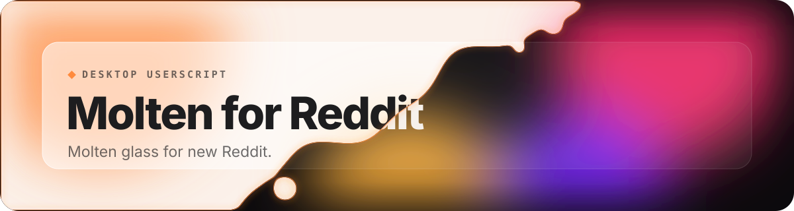
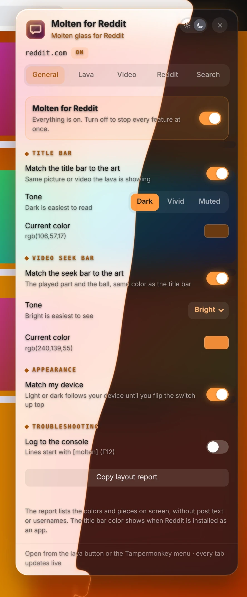
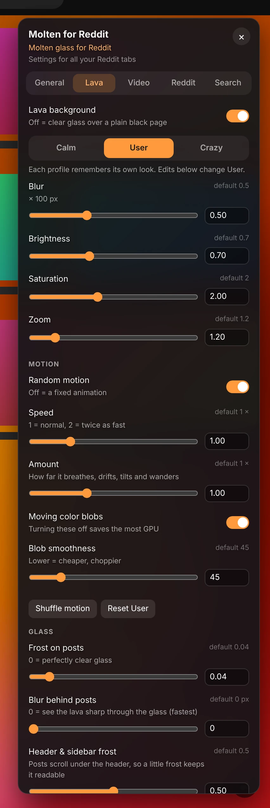
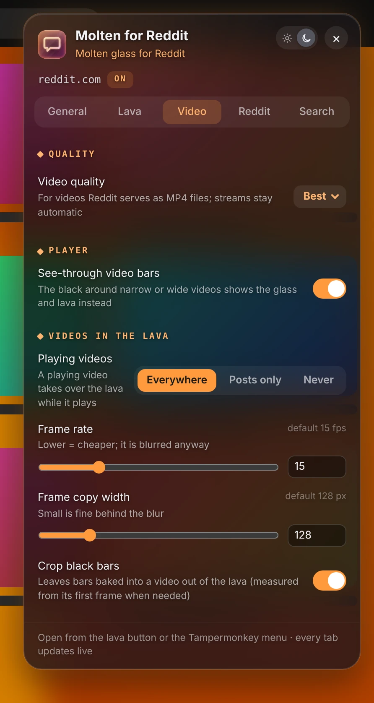
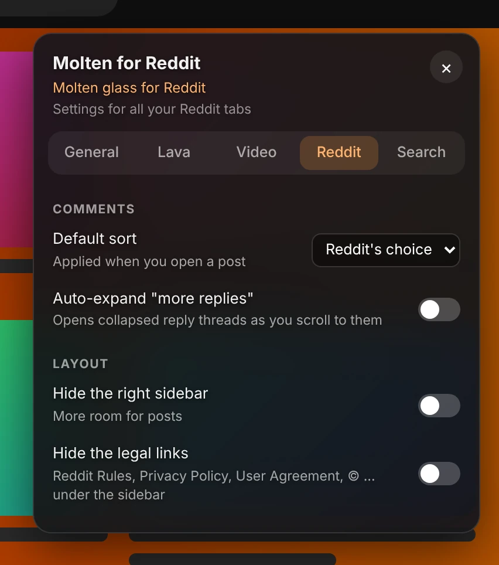
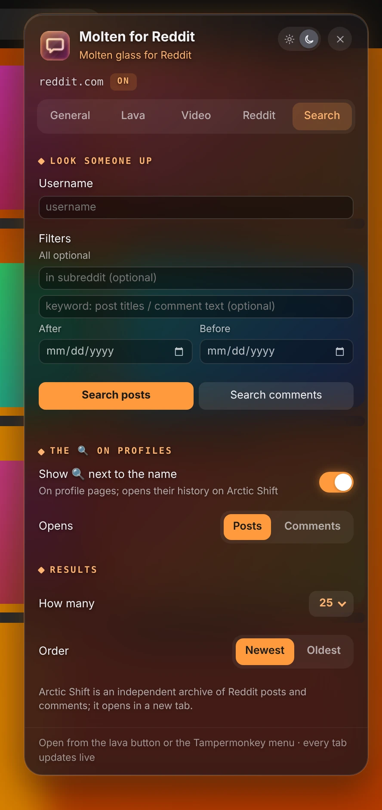

 

 

Molten for Reddit puts a lava-lamp background made from the image or video you are looking at behind clear-glass posts and comments. Click the orange lava button in the top bar for settings.

## Features

- **Lava from what you're looking at**: The background comes from the image or video in the middle of the screen, or the subreddit's banner when there isn't one.
- **Clear-glass posts**: Frost, blur, roundness and outline you can tune, so the lava shows through without hurting readability.
- **Calm, User or Crazy**: Three profiles, each with its own blur, brightness, color and motion.
- **Video, done right**: The best MP4 quality, glass instead of black bars, and playing videos that take over the lava.
- **Colors from the art**: The title bar and seek bar match the post.
- **Reddit, tidied up**: Your default comment sort, replies that expand themselves, and an optional cleaner layout.
- **Look anyone up**: Search a user's posts and comments on Arctic Shift, with a 🔍 next to names on profiles.

## A closer look

<table>
<tr><td align="center" valign="top"><picture><source media="(prefers-color-scheme: light)" srcset="images/lava-light.webp"></picture> <b>Lava</b></td><td align="center" valign="top"><picture><source media="(prefers-color-scheme: light)" srcset="images/video-light.webp"></picture> <b>Video</b></td></tr>
<tr><td align="center" valign="top"><picture><source media="(prefers-color-scheme: light)" srcset="images/reddit-light.webp"></picture> <b>Reddit</b></td><td align="center" valign="top"><picture><source media="(prefers-color-scheme: light)" srcset="images/search-light.webp"></picture> <b>Search</b></td></tr>
</table>

## What's new

- **2.4.9** (2026-11-11): Opening reply threads on its own now stops at exactly 150 per page (it allowed 151). If the browser blocks the page's storage, the comment-sort step is skipped instead of stopping the script from starting.
- **2.4.8** (2026-11-11): Settings that belong to a switch now fold away while it's off (lava, random motion, videos in the lava, title bar and seek bar colors, the sidebar, the profile 🔍) instead of sitting there dimmed. Turn the switch on and they're back as you left them.
- **2.4.7** (2026-11-07): Security fixes.

[Every change](CHANGES.md)
