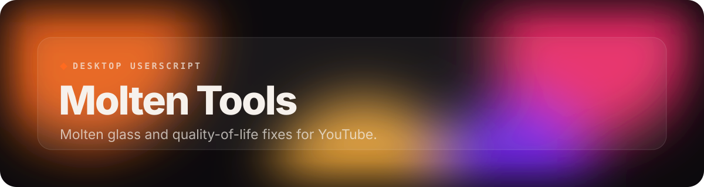
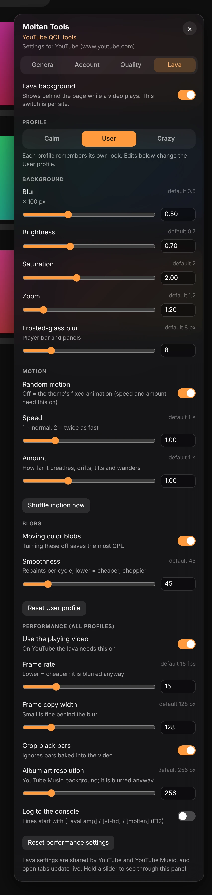
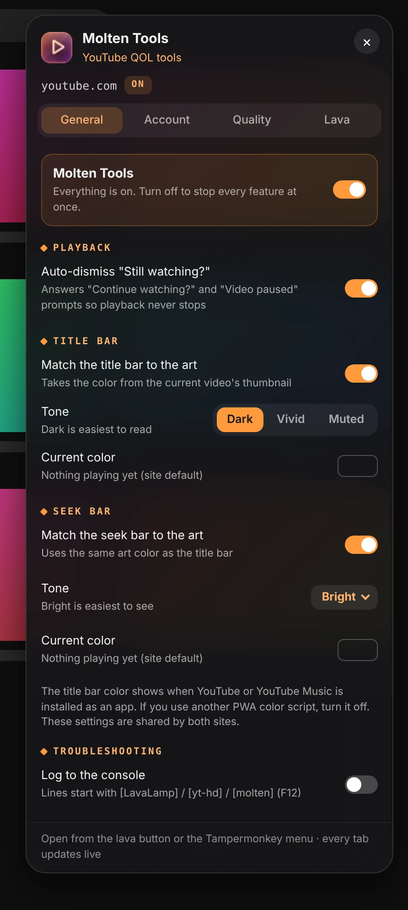
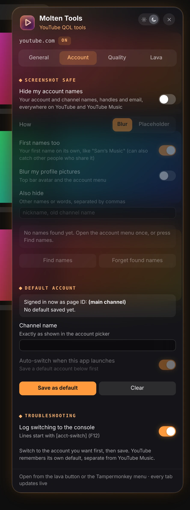
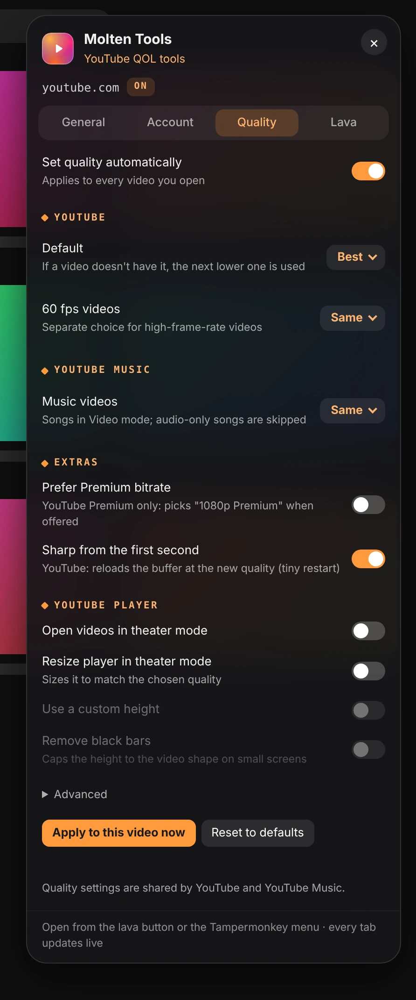

 

 

Molten Tools gives YouTube and YouTube Music a molten-glass lava background, plus a set of quality-of-life fixes. Click the orange lava button in the top bar for settings.

## Features

- **A lava lamp behind every video**: A living background taken from the video or album art, with Calm, User and Crazy profiles that each keep their own look.
- **Never "Still watching?" again**: Answers "Continue watching?" and "Video paused" prompts so playback keeps going.
- **Colors from the art**: The title bar and seek bar take their color from what's playing.
- **Your quality, every time**: Pick a resolution once, with separate choices for high-frame-rate videos and YouTube Music, plus theater mode.
- **Screenshot safe**: Hides your account and channel names, handles and email everywhere on the site.
- **Default account**: Opens YouTube on the account or channel you choose.
- **Tuned for your GPU**: Frame rate, sample size and blob switches keep the lava light on any machine.

## A closer look

<table>
<tr><td align="center" valign="top"> <b>General</b></td><td align="center" valign="top"> <b>Account</b></td></tr>
<tr><td align="center" valign="top"> <b>Quality</b></td></tr>
</table>
