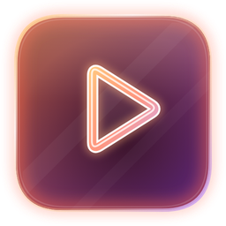
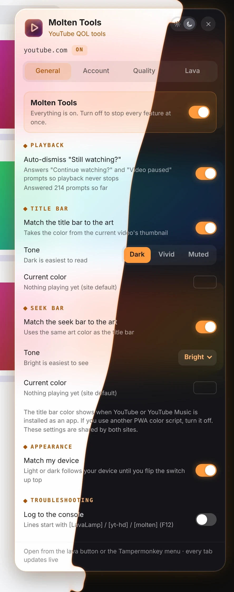

 

 

Molten Tools gives YouTube and YouTube Music a molten-glass lava background, plus a set of quality-of-life fixes. Click the orange lava button in the top bar for settings.

## Features

- **A lava lamp behind every video**: A living background taken from the video or album art, with Calm, User and Crazy profiles that each keep their own look.
- **Never "Still watching?" again**: Answers "Continue watching?" and "Video paused" prompts so playback keeps going.
- **Colors from the art**: The title bar and seek bar take their color from what's playing.
- **Your quality, every time**: Pick a resolution once, with separate choices for high-frame-rate videos and YouTube Music, plus theater mode.
- **Screenshot safe**: Hides your account and channel names, handles and email everywhere on the site.
- **Default account**: Opens YouTube on the account or channel you choose.
- **Tuned for your GPU**: Frame rate, sample size and blob switches keep the lava light on any machine.

## A closer look

<table>
<tr><td align="center" valign="top"><picture><source media="(prefers-color-scheme: light)" srcset="images/account-light.webp"></picture> <b>Account</b></td><td align="center" valign="top"><picture><source media="(prefers-color-scheme: light)" srcset="images/quality-light.webp"></picture> <b>Quality</b></td></tr>
<tr><td align="center" valign="top"><picture><source media="(prefers-color-scheme: light)" srcset="images/lava-light.webp"></picture> <b>Lava</b></td></tr>
</table>

## What's new

- **3.8.1** (2026-11-11): Settings that belong to a switch now fold away while it's off (quality, player size, lava, random motion, title bar and seek bar colors) instead of sitting there dimmed. Turn the switch on and they're back as you left them.
- **3.8.0** (2026-11-10): Screenshot safe now sits under Default account in the Account tab. While it's off, only its switch shows; turn it on and its settings open up. While Screenshot safe is on, the panel hides your saved account name and page ID too. Point at them, or click into the box, to read them.
- **3.7.8** (2026-11-07): Logs never name your accounts, and no more bouncing between pages when the saved account is missing.

[Every change](CHANGES.md)
