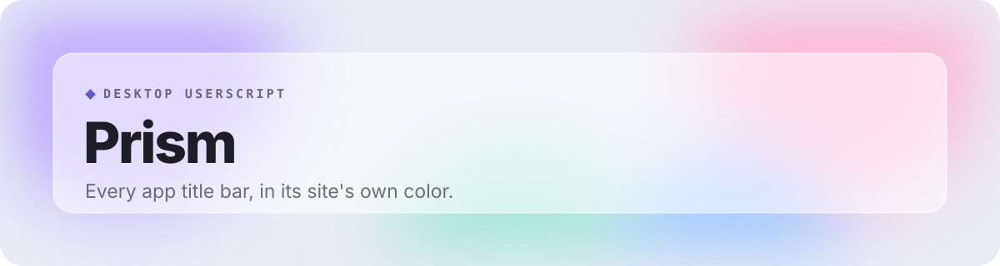

 

 

Prism colors the title bar of installed web apps (PWAs) to match the site you are on. It reads the color from the app icon, the manifest, the page's own theme color, the favicon or the page header, in whatever order you choose.

## Features

- **Five color sources**: App icon, manifest, the site's theme color, favicon and page header. Drag them into your order; the first one that works wins.
- **See what it found**: A live trail shows which sources hit or missed on the page you're on, and which one is in use.
- **Exact, darker or brighter**: Use the color exactly as found, or shift it to sit better with your theme.
- **Your color, per site**: Type a hex value, pick one with the color dropper, or leave a site's title bar alone.
- **Always a fallback**: A color of your choice for pages where nothing else works.
- **Live everywhere**: One master switch, and every open tab updates the moment you change something.
- **A menu that matches**: A frosted panel tinted by the current title bar color. Open it with Alt + Shift + P.
