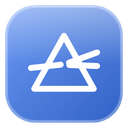
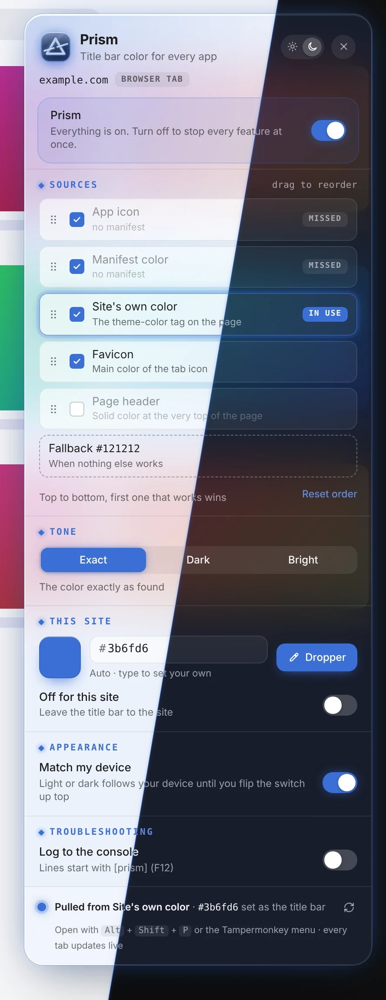

 

 

Prism colors the title bar of installed web apps (PWAs) to match the site you are on. It reads the color from the app icon, the manifest, the page's own theme color, the favicon or the page header, in whatever order you choose.

## Features

- **Five color sources**: App icon, manifest, the site's theme color, favicon and page header. Drag them into your order; the first one that works wins.
- **See what it found**: A live trail shows which sources hit or missed on the page you're on, and which one is in use.
- **Exact, darker or brighter**: Use the color exactly as found, or shift it to sit better with your theme.
- **Your color, per site**: Type a hex value, pick one with the color dropper, or leave a site's title bar alone.
- **Always a fallback**: A color of your choice for pages where nothing else works.
- **Live everywhere**: One master switch, and every open tab updates the moment you change something.
- **A menu that matches**: A frosted panel tinted by the current title bar color. Open it with Alt + Shift + P.

## What's new

- **2.2.11** (2026-11-11): A redirect is checked before it's followed: a site's manifest or icon that redirects to your own computer or home network is now never asked for there. Before, the request was made and only its answer thrown away. Redirects to other public addresses still work.
- **2.2.10** (2026-11-11): Prism never asks your own computer or home network for a manifest or icon a site points at, also when the browser asks rather than Tampermonkey. Before, the browser could still be asked, and some addresses written another way ([::ffff:192.168.1.1], "localhost.", 100.64.x.x) got past the check entirely.
- **2.2.9** (2026-11-11): Turning Prism off and back on while another script (like Molten) is coloring the title bar no longer leaves it stuck on "Prism is off". It says it's standing by again, with Take over, and colors the title bar itself once the other script lets go. The same for turning it off and back on for one site.

[Every change](CHANGES.md)
