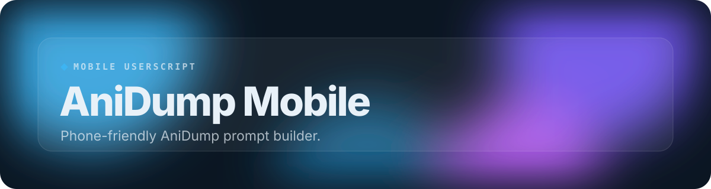
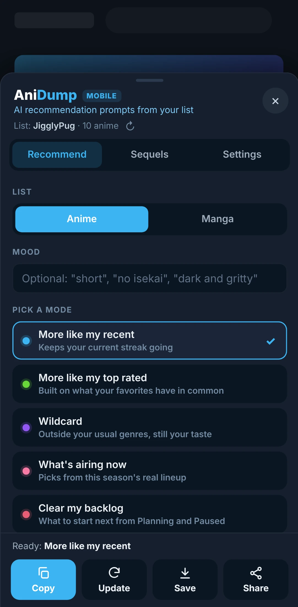
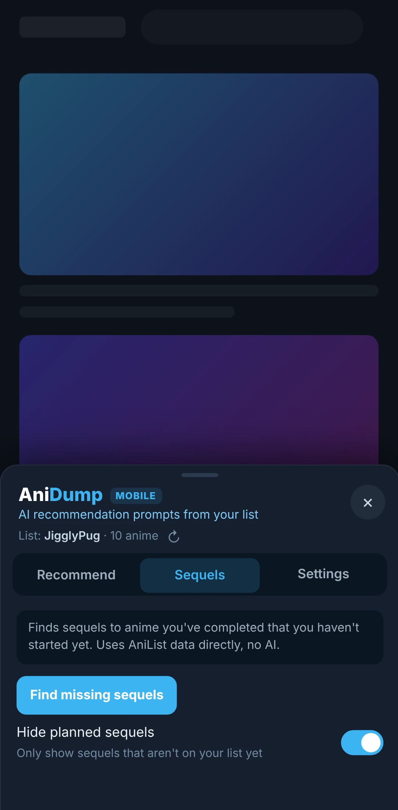
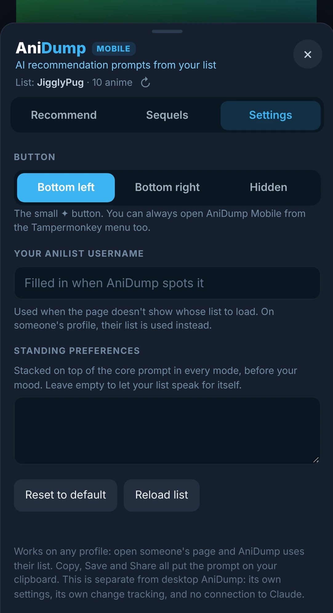

 

 

This is the phone version of AniDump, built for Edge on Android. It uses the same prompts but has no Claude automation: pick a mode, then Copy, Save or Share the prompt.

## Features

- **The same five modes**: Identical prompts to desktop AniDump, for anime and manga.
- **Copy, Save or Share**: Send the prompt to whatever AI app you use on your phone.
- **Update prompts**: Builds a "what changed since last time" prompt from your list.
- **Change tracking**: See what's new on your list since your last prompt.
- **Sequel finder**: Sequels you haven't started, straight from AniList.
- **Made for thumbs**: A bottom sheet that opens from a small ✦ button or the Tampermonkey menu.

## A closer look

<table>
<tr><td align="center" valign="top"> <b>Sequels</b></td><td align="center" valign="top"> <b>Settings</b></td></tr>
</table>
