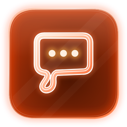
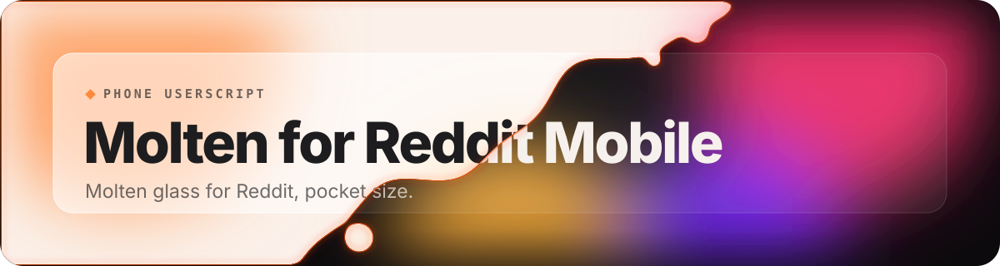
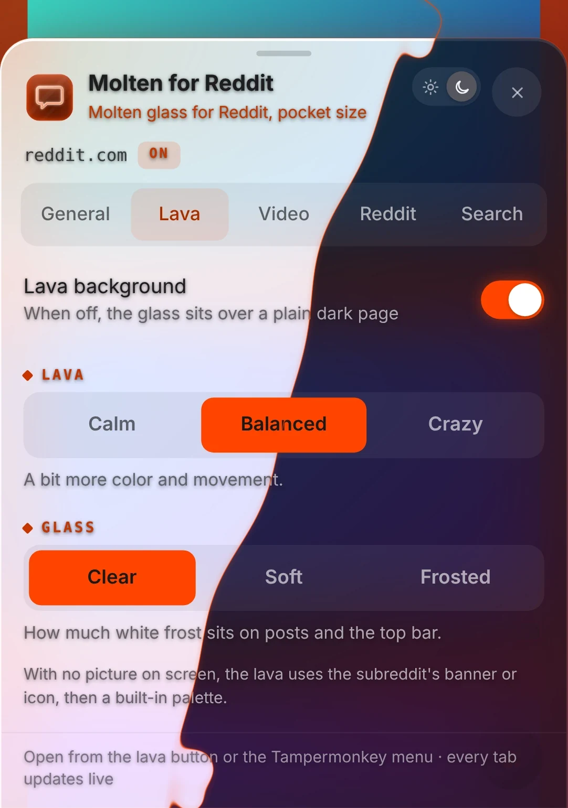
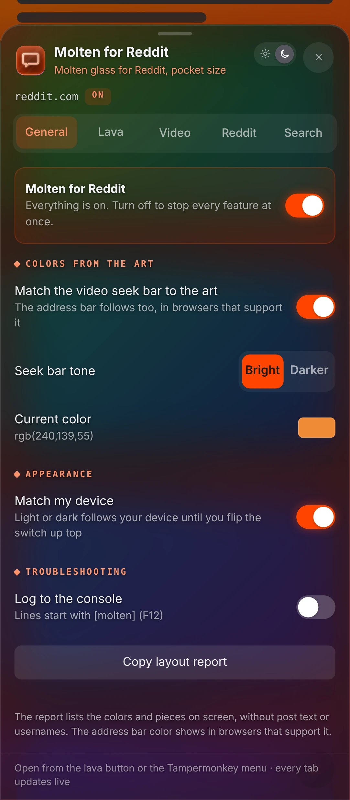
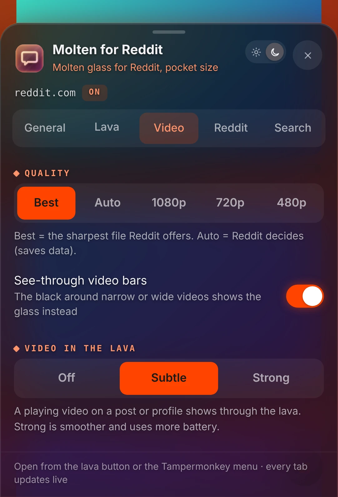
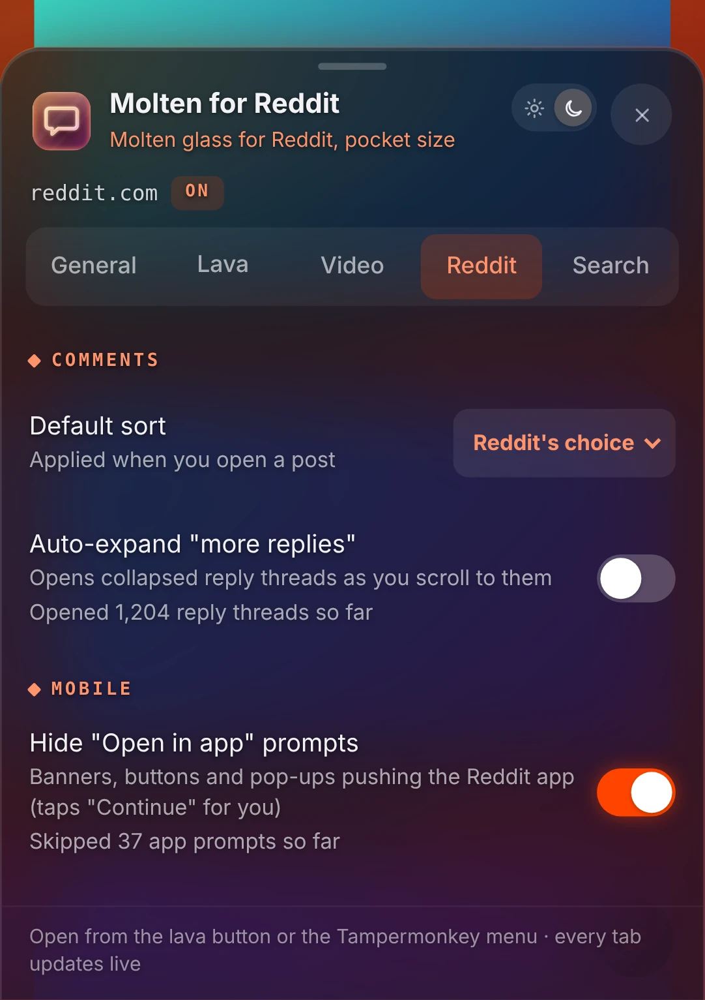
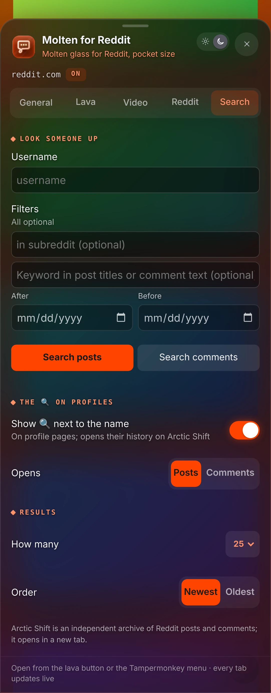

 

 

This is the phone version of Molten for Reddit: a gentle lava background from the post you are looking at, clear-glass posts and comments, with simpler controls made for touch.

## Features

- **Gentle lava**: Calm, Balanced or Crazy, made from the post you're looking at.
- **Glass to taste**: Clear, Soft or Frosted posts and top bar.
- **Colors from the art**: The seek bar and even the address bar follow the post, where the browser supports it.
- **Pick your quality**: Best, Auto, 1080p, 720p or 480p, with video shining through the lava.
- **No "Open in app"**: App banners and pop-ups disappear, and "Continue" gets tapped for you.
- **Comment sort and lookups**: Comment sort, auto-expanding replies and Arctic Shift lookup.

## A closer look

<table>
<tr><td align="center" valign="top"><picture><source media="(prefers-color-scheme: light)" srcset="images/general-light.webp"></picture> <b>General</b></td><td align="center" valign="top"><picture><source media="(prefers-color-scheme: light)" srcset="images/video-light.webp"></picture> <b>Video</b></td><td align="center" valign="top"><picture><source media="(prefers-color-scheme: light)" srcset="images/reddit-light.webp"></picture> <b>Reddit</b></td><td align="center" valign="top"><picture><source media="(prefers-color-scheme: light)" srcset="images/search-light.webp"></picture> <b>Search</b></td></tr>
</table>

## What's new

- **1.4.16** (2026-11-20): The vote, comment and share buttons stay drawn after you scroll: when scrolling stops, and when new posts load in, the page restyles itself the way a change in the panel does, so you don't have to tap or change a setting to bring them back.
- **1.4.15** (2026-11-20): The vote, comment and share buttons no longer go blank after you scroll. When scrolling stops, the posts on screen are drawn again, so you don't have to tap to bring them back.
- **1.4.14** (2026-11-19): A new icon in the family style: the speech bubble's tail has melted into a heavy drop.

[Every change](CHANGES.md)
