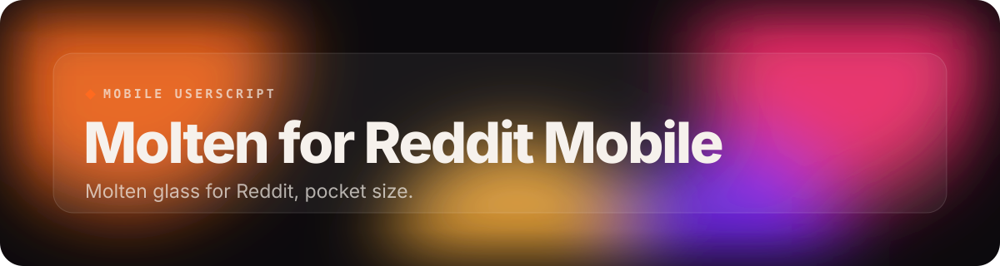
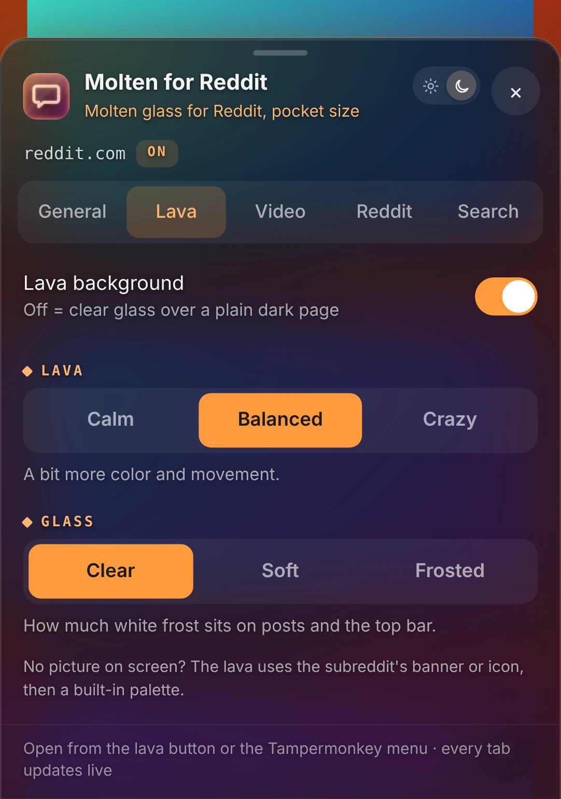
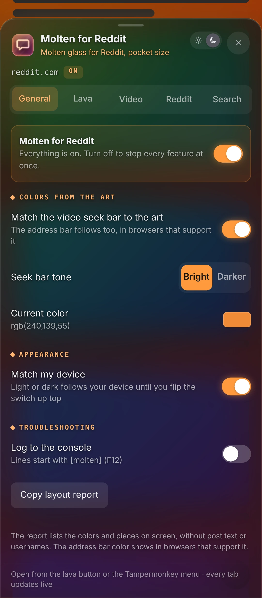
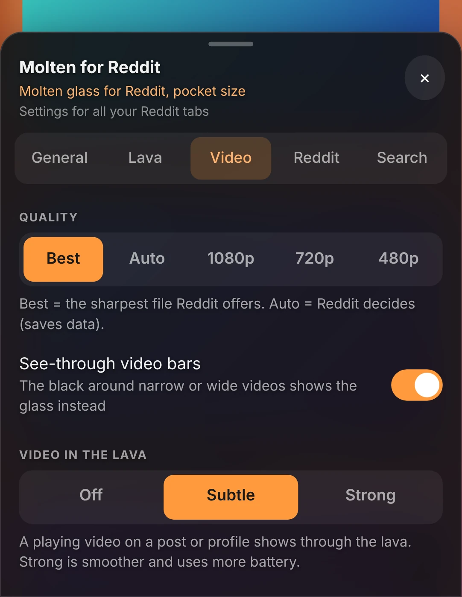
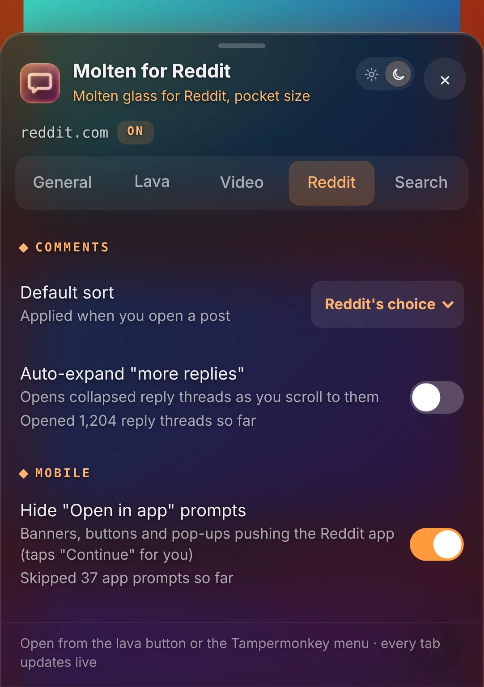
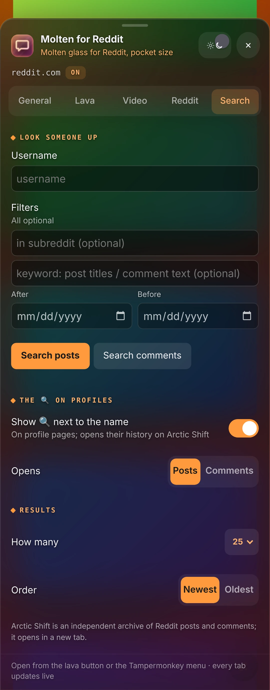

 

 

This is the phone version of Molten for Reddit: a gentle lava background from the post you are looking at, clear-glass posts and comments, with simpler controls made for touch.

## Features

- **Gentle lava**: Calm, Balanced or Crazy, made from the post you're looking at.
- **Glass to taste**: Clear, Soft or Frosted posts and top bar.
- **Colors from the art**: The seek bar and even the address bar follow the post, where the browser supports it.
- **Pick your quality**: Best, Auto, 1080p, 720p or 480p, with video shining through the lava.
- **No "Open in app"**: App banners and pop-ups disappear, and "Continue" gets tapped for you.
- **All the good parts**: Comment sort, auto-expanding replies and Arctic Shift lookup.

## A closer look

<table>
<tr><td align="center" valign="top"> <b>General</b></td><td align="center" valign="top"> <b>Video</b></td><td align="center" valign="top"> <b>Reddit</b></td><td align="center" valign="top"> <b>Search</b></td></tr>
</table>
